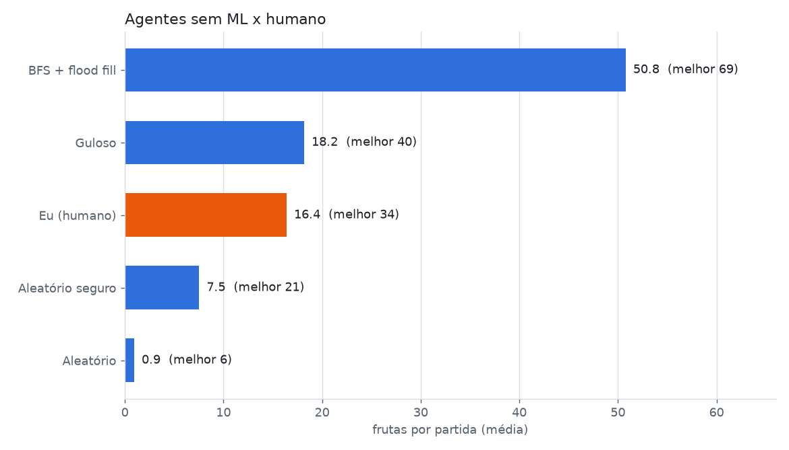
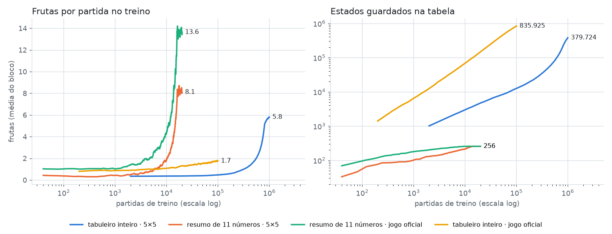
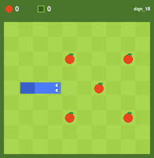
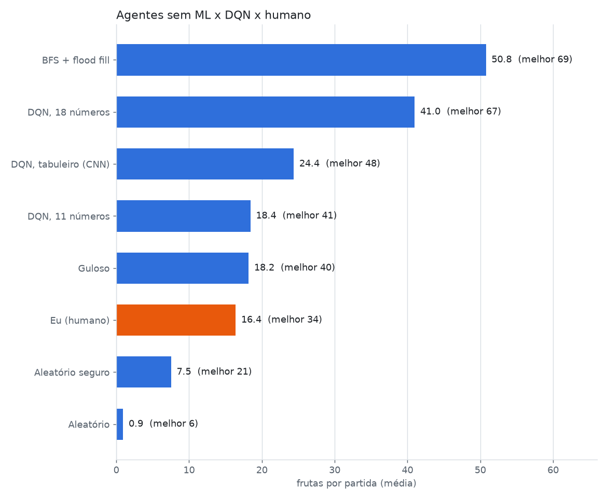
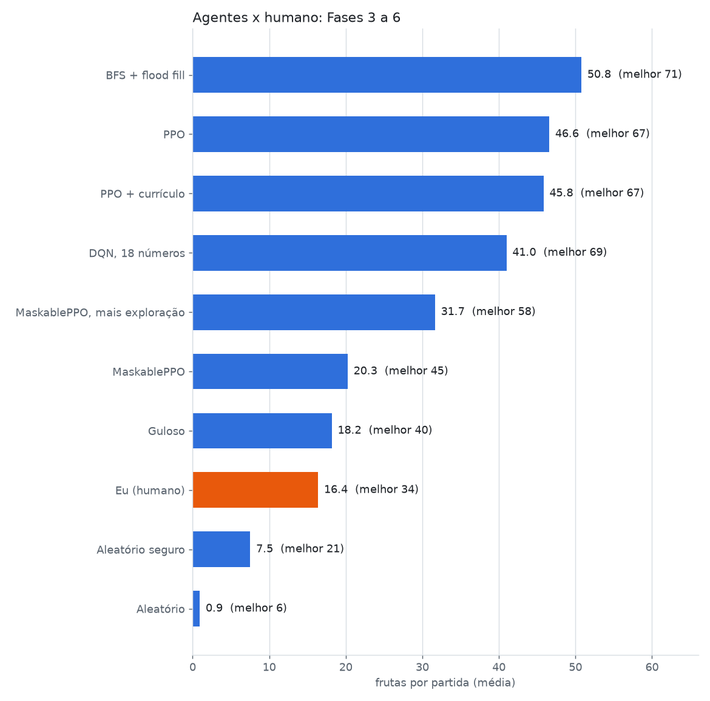
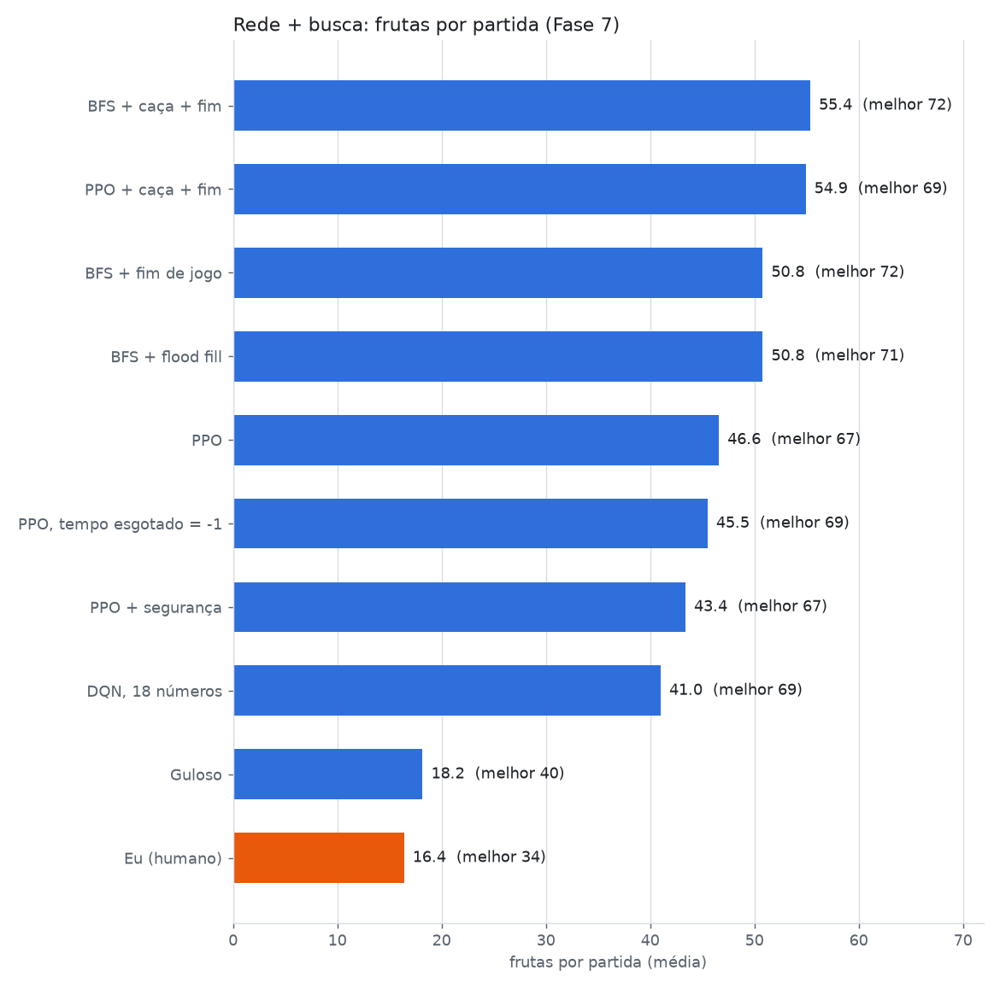

# Snake RL

Agente de aprendizado por reforço que aprende a jogar uma versão do Snake com
obstáculos permanentes (inspirada no Snake do Google). Projeto de portfólio.

> Em construção — o progresso de cada fase fica em `docs/fases/`.

**Referência humana (Fase 2):** em 20 partidas, eu fiz **16,4 frutas de média**, com
**recorde de 34**. É isso que a IA vai tentar bater.


**Agentes (Fases 3 a 7), 1.000 partidas cada nas mesmas sementes:**

| Jogador | Média de frutas | Melhor | Vitórias |
|---|---:|---:|---:|
| Aleatório | 0,94 | 6 | 0% |
| Aleatório seguro | 7,53 | 21 | 0% |
| Eu (humano, 20 partidas) | 16,40 | 34 | 0% |
| Guloso | 18,18 | 40 | 0% |
| DQN, 18 números (Fase 5) | 41,00 | 69 | 0% |
| PPO (Fase 6) | 46,59 | 67 | 0% |
| BFS + flood fill | 50,79 | 71 | 0% |
| PPO + caça + fim (Fase 7) | 54,91 | 69 | 0% |
| BFS + caça + fim (Fase 7) | **55,35** | 72 | **0,1%** |



**Primeiro RL (Fase 4): Q-learning com tabela.** Com o tabuleiro inteiro como estado,
ele aprende no 5×5, mas no jogo oficial a tabela explode: 836 mil estados, e mesmo
assim 56% das situações da avaliação são novas. Com um resumo de 11 números, ele
chega a 17,4 frutas de média. O próximo passo é uma rede neural (DQN).



**DQN em PyTorch (Fase 5).** Com o mesmo resumo de 11 números, a rede empata com a
tabela (18,4). Com 7 números a mais sobre espaço livre e alcance da cauda, ela faz
**41,0 frutas de média** (2,5× a minha) e passa do meu recorde em 75% das partidas.
Vendo o tabuleiro cru, uma rede convolucional (CNN) chega a 24,4. Ninguém zerou o
jogo ainda: a melhor partida do DQN chegou a 69 frutas, com 2 sobrando.





**PPO com Stable-Baselines3 (Fase 6).** Jogando 8 partidas em paralelo, o PPO chega a
**46,6 frutas de média** e passa do meu recorde em 85% das partidas: o melhor agente que
aprendeu sozinho, a 4 frutas do BFS. Como o BFS, ele termina dando voltas no fim de jogo,
sem arriscar as últimas frutas. Zerar o jogo é o desafio da Fase 7.




**Rede + busca (Fase 7): a primeira vitória.** Uma conta de tabuleiro de xadrez mostra que
em ~64% das partidas zerar é **impossível** (o corpo alterna as cores, e os obstáculos
desequilibram as casas livres). Com uma busca que caça caminhos mais longos até a fruta, o PPO
sobe de 46,6 para 54,9 frutas. E um solucionador exato de fim de jogo zerou 1 das 1.000 partidas.




## Como rodar (Windows / PowerShell)

```powershell
# 1. Criar o ambiente virtual com Python 3.12
py -3.12 -m venv .venv

# 2. Instalar as dependências
.venv\Scripts\python.exe -m pip install -r requirements.txt

# 3. Rodar os testes
.venv\Scripts\python.exe -m pytest

# 4. Jogar! (setas ou WASD; Espaço pausa; Esc sai)
.venv\Scripts\python.exe scripts\play.py

# 5. Ver as estatísticas das suas partidas gravadas (e gerar o resumo das 20 oficiais)
.venv\Scripts\python.exe scripts\human_stats.py

# 6. Estressar o motor do jogo com 10.000 partidas aleatórias
.venv\Scripts\python.exe scripts\random_games.py --games 10000

# 7. Avaliar os agentes nas 1.000 sementes oficiais (tabela + gráfico, ~80 s)
.venv\Scripts\python.exe scripts\evaluate.py

# 8. Treinar um Q-learning com tabela (Fase 4) no tabuleiro 5×5 (~10 s)
.venv\Scripts\python.exe scripts\train_qlearning.py --board mini --obs features --episodes 20000 --out teste_q

# 9. Treinar um DQN (Fase 5). Antes, instale o PyTorch com CUDA (veja requirements.txt). ~13 min
.venv\Scripts\python.exe scripts\train_dqn.py --obs features_space --steps 1000000 --eval-every 100000 --out teste_dqn

# 10. Avaliar a rede treinada junto com os outros agentes
.venv\Scripts\python.exe scripts\evaluate.py --agents greedy bfs --model dqn=experiments/teste_dqn/model.pt --out teste_comparacao --no-chart

# 11. Treinar um PPO (Fase 6), 8 tabuleiros em paralelo (~15 min)
.venv\Scripts\python.exe scripts\train_ppo.py --steps 4000000 --out teste_ppo

# 12. Avaliar um agente com busca por cima (Fase 7): 100 partidas, ~3 min
.venv\Scripts\python.exe scripts\evaluate.py --agents --wrap bfs_caca_fim=bfs:caca,fim --games 100 --out teste_busca --no-chart
```

## Usando o motor do jogo

```python
from snake.env import SnakeGame, UP, RIGHT, DOWN, LEFT

game = SnakeGame(seed=42)        # mesma seed = mesma partida
result = game.step(RIGHT)        # anda uma casa
print(game)                      # H cabeça, o corpo, * fruta, # obstáculo
print(game.get_state())          # estado completo (seção 8 da especificação)
```

## Estrutura

| Pasta | Conteúdo |
|---|---|
| `snake/` | Motor do jogo e interface com o Gymnasium |
| `agents/` | Agentes: aleatório, guloso, BFS, Q-learning, DQN e PPO |
| `scripts/` | Jogar, treinar, avaliar, gerar vídeos |
| `tests/` | Testes automatizados (pytest) |
| `replays/` | Partidas gravadas (seed + ações), reproduzíveis |
| `docs/` | Especificação, relatório de cada fase e diário |
| `experiments/` | Um diretório por experimento de treino |
