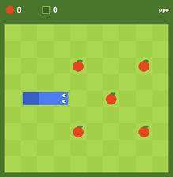
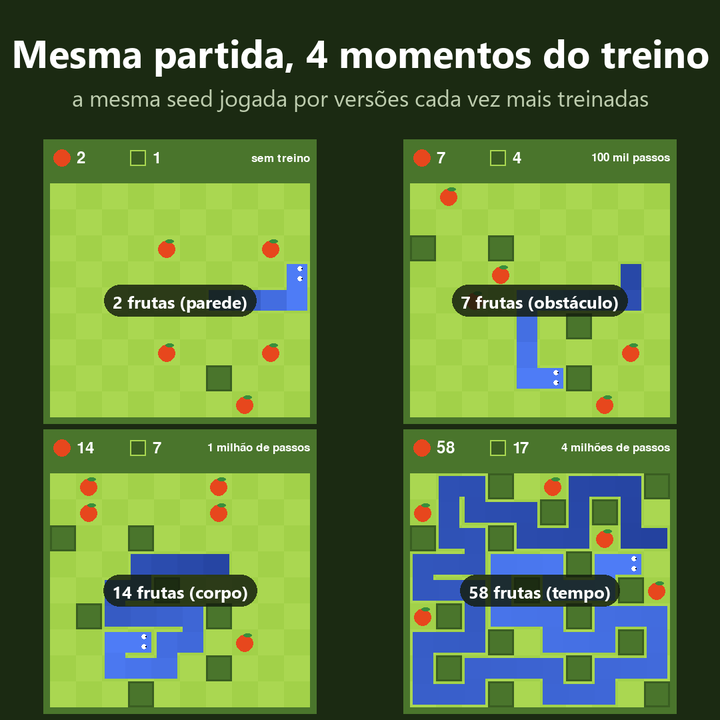
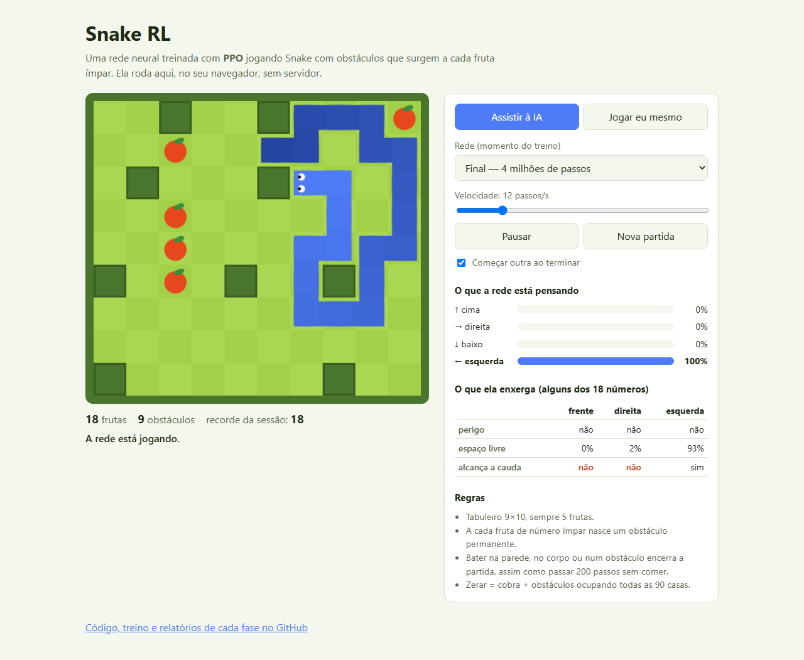

# Snake RL

Uma rede neural que aprendeu sozinha a jogar Snake com **obstáculos permanentes** que nascem a
cada fruta ímpar. A versão do jogo é inspirada no Snake do Google. Construí o projeto em 8 fases,
do motor do jogo até redes treinadas com DQN e PPO e uma busca que conseguiu zerar o jogo. É
um projeto de portfólio, e cada fase tem um relatório didático em `docs/fases/`.

**[▶ Jogue contra a rede no navegador](https://mateusbau.github.io/snake-rl/)** ·
**[🎬 Vídeo de 1 minuto](docs/media/snake_rl.mp4)** ·
**[📓 Diário do projeto](docs/diario.md)**



## Resultados

Todos os agentes jogaram as **mesmas 1.000 partidas** (mesmas sementes, `scripts/evaluate.py`).
As minhas são as 20 partidas oficiais que joguei na Fase 2.

| Jogador | Como decide | Média de frutas | Melhor | Vitórias |
|---|---|---:|---:|---:|
| Aleatório | sorteio | 0,94 | 6 | 0% |
| **Eu (humano)** | teclado | **16,40** | 34 | 0% |
| Guloso | regra: vai na fruta mais perto | 18,18 | 40 | 0% |
| DQN (Fase 5) | rede neural, aprendeu sozinha | 41,00 | 69 | 0% |
| PPO (Fase 6) | rede neural, aprendeu sozinha | 46,59 | 67 | 0% |
| BFS + flood fill (Fase 3) | busca escrita à mão | 50,79 | 71 | 0% |
| PPO + busca (Fase 7) | rede sugere, busca confere | 54,91 | 69 | 0% |
| BFS + busca (Fase 7) | busca + solucionador de fim de jogo | **55,35** | **72** | **0,1%** |

- **A rede passou de mim:** o PPO faz 2,8× a minha média e passa do meu recorde (34) em 85% das partidas.
- **Zerar é raro por um motivo matemático.** Pinte o tabuleiro como um xadrez: o corpo da cobra
  alterna as cores, mas os obstáculos nascem em casas sorteadas e desequilibram as cores livres.
  Em ~64% das partidas, zerar fica **impossível** para qualquer jogador. A primeira vitória
  veio de um solucionador exato de fim de jogo: 1 em 1.000 partidas.


## A história, fase a fase

| Fase | O que entrou | Resultado | Relatório |
|---|---|---|---|
| 0–1 | Motor do jogo em Python puro, sem tela, testado | 10.000 partidas aleatórias sem erro | [fase-1](docs/fases/fase-1.md) |
| 2 | Versão jogável (pygame) e replays (seed + ações) | Minha referência: 16,4 de média, recorde 34 | [fase-2](docs/fases/fase-2.md) |
| 3 | Agentes sem ML: guloso, BFS + flood fill | BFS faz 50,8: a régua das redes | [fase-3](docs/fases/fase-3.md) |
| 4 | Gymnasium e Q-learning com tabela | Aprende no 5×5; no 9×10 a tabela explode (836 mil estados) | [fase-4](docs/fases/fase-4.md) |
| 5 | DQN em PyTorch (vetor e CNN) | 41,0 com 18 números sobre espaço livre | [fase-5](docs/fases/fase-5.md) |
| 6 | PPO com Stable-Baselines3, 8 partidas em paralelo | 46,6: a melhor rede | [fase-6](docs/fases/fase-6.md) |
| 7 | Rede + busca, paridade | 55,4 de média e a 1ª vitória | [fase-7](docs/fases/fase-7.md) |
| 8 | Demo web (ONNX + JS), vídeo, este README | Links prontos | [fase-8](docs/fases/fase-8.md) |

**Mesma partida, 4 momentos do treino** (quadro do vídeo): sem treino, a cobra bate na parede
com 2 frutas. Com 4 milhões de passos, ela faz 58.



**O que a rede enxerga.** Ela não vê o tabuleiro inteiro. Vê 18 números: perigo em volta da
cabeça, a direção, onde está a fruta mais próxima, quanto espaço livre sobra em cada jogada e se
a cabeça ainda alcança a cauda. Com só os 11 primeiros, o DQN ficava em 18 frutas; os 7 sobre
espaço levaram a 41. Na demo web dá para ver esses números mudando a cada passo.



**Como a demo roda sem servidor.** A rede do PPO foi exportada para ONNX (77 KB) e roda no
navegador com o onnxruntime-web. O motor do jogo e os 18 números foram reescritos em
JavaScript, e um teste compara o JS com o Python em 138 estados de partidas reais.

## Como rodar (Windows / PowerShell)

```powershell
# 1. Criar o ambiente virtual com Python 3.12
py -3.12 -m venv .venv

# 2. Instalar as dependências
.venv\Scripts\python.exe -m pip install -r requirements.txt

# 3. Rodar os testes (Python + paridade do JavaScript, se o Node estiver instalado)
.venv\Scripts\python.exe -m pytest

# 4. Jogar! (setas ou WASD; Espaço pausa; Esc sai)
.venv\Scripts\python.exe scripts\play.py

# 5. Ver as estatísticas das suas partidas gravadas (e gerar o resumo das 20 oficiais)
.venv\Scripts\python.exe scripts\human_stats.py

# 6. Estressar o motor do jogo com 10.000 partidas aleatórias
.venv\Scripts\python.exe scripts\random_games.py --games 10000

# 7. Avaliar os agentes nas 1.000 sementes oficiais (tabela + gráfico, ~80 s)
.venv\Scripts\python.exe scripts\evaluate.py

# 8. Treinar um Q-learning com tabela (Fase 4) no tabuleiro 5×5 (~10 s)
.venv\Scripts\python.exe scripts\train_qlearning.py --board mini --obs features --episodes 20000 --out teste_q

# 9. Treinar um DQN (Fase 5). Antes, instale o PyTorch com CUDA (veja requirements.txt). ~13 min
.venv\Scripts\python.exe scripts\train_dqn.py --obs features_space --steps 1000000 --eval-every 100000 --out teste_dqn

# 10. Avaliar a rede treinada junto com os outros agentes
.venv\Scripts\python.exe scripts\evaluate.py --agents greedy bfs --model dqn=experiments/teste_dqn/model.pt --out teste_comparacao --no-chart

# 11. Treinar um PPO (Fase 6), 8 tabuleiros em paralelo (~15 min)
.venv\Scripts\python.exe scripts\train_ppo.py --steps 4000000 --out teste_ppo

# 12. Avaliar um agente com busca por cima (Fase 7): 100 partidas, ~3 min
.venv\Scripts\python.exe scripts\evaluate.py --agents --wrap bfs_caca_fim=bfs:caca,fim --games 100 --out teste_busca --no-chart

# 13. Exportar o PPO para ONNX e abrir a demo web em http://localhost:8000 (Fase 8)
.venv\Scripts\python.exe scripts\export_onnx.py
.venv\Scripts\python.exe -m http.server 8000 --directory web

# 14. Gerar o vídeo de ~1 min em docs\media\snake_rl.mp4 (~40 s)
.venv\Scripts\python.exe scripts\make_video.py
```

## Usando o motor do jogo

```python
from snake.env import SnakeGame, UP, RIGHT, DOWN, LEFT

game = SnakeGame(seed=42)        # mesma seed = mesma partida
result = game.step(RIGHT)        # anda uma casa
print(game)                      # H cabeça, o corpo, * fruta, # obstáculo
print(game.get_state())          # estado completo (seção 8 da especificação)
```

## Estrutura

| Pasta | Conteúdo |
|---|---|
| `snake/` | Motor do jogo e interface com o Gymnasium |
| `agents/` | Agentes: aleatório, guloso, BFS, Q-learning, DQN, PPO e as camadas de busca |
| `scripts/` | Jogar, treinar, avaliar, exportar para ONNX, gerar GIFs e o vídeo |
| `web/` | Demo no navegador: motor em JS, os 18 números, a rede em ONNX |
| `tests/` | Testes automatizados (pytest; o JS com `node --test`) |
| `replays/` | Partidas gravadas (seed + ações), reproduzíveis |
| `docs/` | Especificação, relatório de cada fase e diário |
| `experiments/` | Um diretório por experimento de treino |

Feito com Python, PyTorch, Stable-Baselines3, Gymnasium, pygame e onnxruntime-web.
