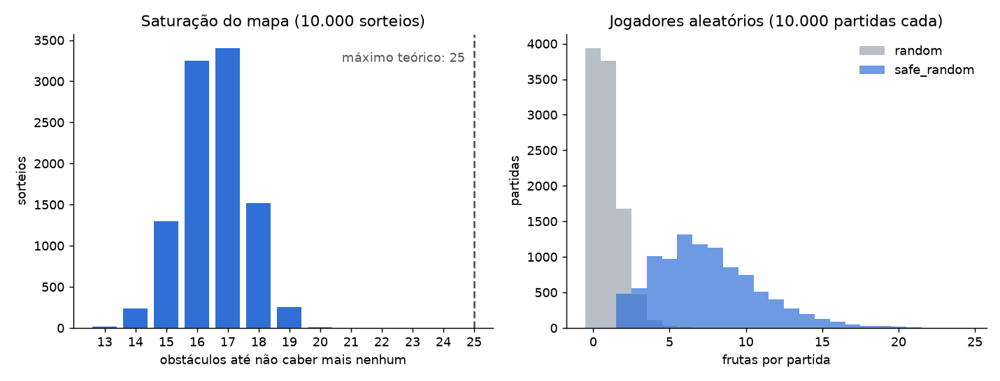

# Fase 1 — Motor do jogo

## O que foi feito

| Arquivo | Papel |
|---|---|
| `snake/env.py` | O jogo inteiro (regras), sem tela e sem ML: classe `SnakeGame` + `GameConfig` |
| `snake/checks.py` | `check_invariants()`: regras que precisam valer em **todo** passo |
| `tests/test_env.py` | Os 15 testes da seção 10 da especificação + 5 extras (decisões do CLAUDE.md) |
| `scripts/random_games.py` | Roda 10.000 partidas aleatórias conferindo as invariantes a cada passo |

O motor implementa todas as regras da especificação e as decisões do CLAUDE.md:
5 frutas sempre (iniciais fixas), +1 célula por fruta, 1 tentativa de obstáculo a
cada fruta ímpar, obstáculos sem encostar nas 8 direções e fora das 3 células à
frente da cabeça, sorteio uniforme, meia-volta ignorada, limite de 200 passos sem
comer, vitória quando não há onde repor fruta, e tudo reproduzível por seed.

**Decisão nova (confirmada nesta fase):** entrar na célula da cauda é permitido
quando a cobra não cresce naquele passo, porque a cauda sai do lugar junto.

## Conceitos novos

### 1. Classe e `self` (≈ `class` e `this` do JS)

```python
class SnakeGame:
    def __init__(self, config=None, seed=None):   # = constructor(config, seed)
        self.config = config or GameConfig()     # = this.config = config || new GameConfig()
```

### 2. `@dataclass`: objetos de configuração sem escrever construtor

```python
@dataclass(frozen=True)
class GameConfig:
    height: int = 9
    width: int = 10

GameConfig()                 # GameConfig(height=9, width=10)
GameConfig(height=5)         # muda só a altura
```
`frozen=True` = `Object.freeze()`: ninguém altera a config no meio do jogo.

### 3. Seed: aleatório, mas reproduzível

```python
rng = np.random.default_rng(42)
rng.integers(10), rng.integers(10)   # sempre (0, 7) com a seed 42
```
Cada partida tem o seu próprio gerador. Para isso funcionar, a lista de células
candidatas precisa sair **sempre na mesma ordem** (linha por linha); o sorteio
escolhe um *índice* dessa lista.

### 4. Exemplo resolvido: um passo do jogo

Partida padrão (`SnakeGame(seed=0)`), apertando → três vezes:

```
Início                 Depois de 3 passos
..........             ..........
..........             ..........
....*...*.             ....*...*.
..........             ..........
.ooH..*...             ...oooH...      <- comeu a fruta (4,6)
..........             ........#.      <- 1ª fruta é ímpar: nasceu obstáculo
....*...*.             ....*...*.
..........             .......*..      <- fruta de reposição
..........             ..........
```

O que o `step(RIGHT)` do 3º passo fez, na ordem:
1. **Mover:** cabeça vai de (4,5) para (4,6).
2. **Colisão?** (4,6) está dentro do mapa, não é obstáculo nem corpo → segue.
3. **Comer:** tinha fruta → `fruits_collected = 1`, a cauda **não** sai (cresce 1).
4. **Repor fruta:** sorteia entre as 81 células vazias → (7,7).
5. **Obstáculo:** 1 é ímpar → monta a lista de células válidas, tirando as ocupadas,
   as vizinhas de obstáculo e a zona de segurança (4,7), (4,8), (4,9) → sorteia (5,8).

O retorno foi:
`StepResult(ate_fruit=True, new_fruit=(7, 7), new_obstacle=(5, 8), game_over=False, end_reason=None)`

### 5. Testes de invariantes

Em vez de testar só casos escolhidos a dedo, rodamos milhares de partidas e, a cada
passo, conferimos regras que **nunca** podem quebrar (nada sobreposto, cobra contínua,
obstáculos sem se encostar, sempre 5 frutas...). É como um `expect` rodando dentro
de um loop gigante.

### 6. Testando "uniforme" com qui-quadrado

Para saber se o sorteio é justo, repetimos o mesmo sorteio 20.000 vezes e contamos
quantas vezes cada célula saiu. Com 80 células, o esperado é 250 cada. O teste
qui-quadrado soma `(observado − esperado)² / esperado` de todas as células: se o
total for grande demais, alguma célula está sendo favorecida. Como a seed é fixa, o
teste nunca "falha por azar".

## Como rodar

```powershell
.venv\Scripts\python.exe -m pytest                                  # 22 testes
.venv\Scripts\python.exe scripts\random_games.py --games 10000     # ~30 s
```

## Resultados

- **pytest:** 22 de 22 testes passando (15 da especificação + 5 extras + 2 da Fase 0).
- **10.000 partidas aleatórias** de cada jogador, sem nenhuma invariante quebrada:

| Jogador | Frutas (média / mediana / máx) | Obstáculos (média / máx) | Fim de jogo |
|---|---|---|---|
| `random` (qualquer direção) | 0,92 / 1 / 7 | 0,67 / 4 | parede 89,5%, obstáculo 5,7%, corpo 4,7% |
| `safe_random` (evita morte imediata) | 7,15 / 7 / 24 | 3,81 / 12 | corpo 43,9%, parede 42,2%, obstáculo 13,8%, tempo 0,1% |

- Velocidade: ~49.000 passos por segundo, num núcleo só.
- **Saturação:** sorteando obstáculos sem parar no mapa inicial, cabem em média
  **19** antes de não sobrar posição válida (mínimo 15, máximo 23). O máximo teórico
  é 25 (o padrão "linha par, coluna par"), mas o sorteio aleatório quase nunca chega lá.



Esses jogadores **não** são os baselines da Fase 3: servem só para estressar o motor.

> **Atualização (regra 4.5, becos sem saída):** depois que a proibição de becos entrou,
> as 10.000 partidas foram rodadas de novo, também sem nenhuma invariante quebrada.
> `safe_random`: 7,46 frutas e 3,96 obstáculos de média (máx. 24 e 12). Saturação: 16,5
> obstáculos em média (13–20). O gráfico acima já é a versão nova. Detalhes no `docs/diario.md`.

## O que deu errado e como foi resolvido

1. **Invariante falhando no teste 13.** A checagem "no máximo 1 obstáculo por fruta
   ímpar" reclamou de um cenário que já começava com 25 obstáculos (montado à mão
   com `load_state`). O jogo estava certo; a checagem é que não sabia descontar os
   obstáculos pré-montados. Solução: o jogo guarda `obstacles_at_start`.
2. **Teste 7 usando `id()` para identificar partidas.** O Python pode reaproveitar o
   `id` de um objeto apagado, misturando partidas diferentes. Trocado por comparar
   o próprio objeto (`game is last_game`).
3. **Gráfico sem graça.** A 1ª versão mostrava "obstáculos × frutas", mas a média
   observada caía exatamente em cima da regra (nunca faltou posição nessas partidas
   curtas). Trocado pelo gráfico de saturação, que mostra algo novo.
