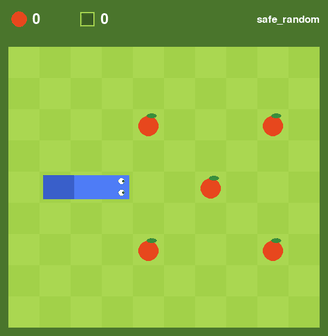

# Fase 2 — Versão jogável

> **Status:** código pronto. Falta a parte humana: você joga 20 partidas e
> registramos sua média e seu recorde (seção "Resultados", abaixo).

## O que foi feito

| Arquivo | Papel |
|---|---|
| `snake/render.py` | Desenha o jogo com pygame (só desenha: não lê teclado nem controla tempo) |
| `snake/replay.py` | Grava partidas como seed + ações; reproduz e confere |
| `scripts/play.py` | Você joga no teclado; toda partida terminada vira um replay em `replays/human/` |
| `scripts/human_stats.py` | Média, mediana, recorde e causas de morte das suas partidas |
| `scripts/replay_to_gif.py` | Transforma um replay em GIF (base do vídeo da Fase 8) |
| `tests/test_replay_render.py` | Replays reproduzem a partida exata; desenho com as cores certas |



*Partida de exemplo de um jogador aleatório que só evita morrer no passo seguinte (12 frutas, 6 obstáculos).*

## Conceitos novos

### 1. Game loop: eventos → atualização → desenho

Todo jogo em tempo real é um laço infinito com três partes, repetido ~120 vezes por
segundo. É o mesmo padrão do `requestAnimationFrame` no JavaScript:

```python
while running:
    for event in pygame.event.get():   # 1) teclado/mouse (≈ addEventListener)
        ...
    while agora - ultimo_passo >= intervalo:
        game.step(acao)                # 2) o jogo anda (no ritmo de 7 passos/s)
    renderer.draw(screen, game)        # 3) desenha
    pygame.display.flip()              #    e mostra (≈ trocar o canvas)
```

Repare que **desenhar** (120x/s) e **andar** (7x/s) são ritmos diferentes. Assim a
tela fica fluida e o jogo não acelera em PC mais rápido.

### 2. Fila de comandos

Se você aperta ↑ e ← muito rápido, as duas teclas chegam entre dois passos. Sem
fila, só a última valeria e a cobra faria meia-volta (ignorada) ou perderia a
curva. Com a fila (`deque`), cada passo consome **um** comando:

```
Andando →. Você aperta ↑ e ← quase juntos.
fila = [↑, ←]
passo 1: usa ↑  -> fila = [←]
passo 2: usa ←  -> fila = []
```

### 3. Replay = seed + ações

Como o motor é determinístico, não precisamos gravar vídeo. Exemplo real:

```json
{
  "seed": 11,
  "actions": [null, null, null, null, null, null, null],
  "result": {"fruits": 1, "steps": 7, "end_reason": "wall", ...}
}
```

`null` = "não apertou nada, manteve a direção". Para assistir de novo, criamos
`SnakeGame(seed=11)` e repetimos as 7 ações: a partida sai idêntica, inclusive as
frutas e os obstáculos sorteados. O `human_stats.py` faz isso com **todos** os
replays e confere se o resultado bate com o gravado.

### 4. Separar desenho e regras

O `render.py` recebe um `SnakeGame` e só pinta. Por isso o mesmo código serve
para: você jogar, assistir a um replay, gerar GIF (sem janela, com
`SDL_VIDEODRIVER=dummy`) e, depois, assistir aos agentes.

## Como rodar

```powershell
.venv\Scripts\python.exe scripts\play.py                 # jogar (padrão: 7 passos/s)
.venv\Scripts\python.exe scripts\play.py --speed 5       # mais devagar
.venv\Scripts\python.exe scripts\human_stats.py          # suas estatísticas
.venv\Scripts\python.exe scripts\play.py --replay replays\human\ARQUIVO.json   # assistir
.venv\Scripts\python.exe scripts\replay_to_gif.py replays\human\ARQUIVO.json docs\media\minha.gif
```

Controles: setas ou WASD; a cobra só começa a andar no 1º toque. Espaço/P pausa,
Enter recomeça depois de perder, Esc sai.

## Resultados

*Pendente: suas 20 partidas.*

## O que deu errado e como foi resolvido

1. **Primeiro toque não começava o jogo.** Se a 1ª tecla fosse →, que já é a direção
   atual, ela não entrava na fila e o jogo continuava esperando. Agora qualquer seta
   começa.
2. **Replay em JSON gigante.** O `json.dumps` com indentação quebrava cada
   coordenada em várias linhas. Ações e configuração agora ficam numa linha só.
3. **Teste do `play.py` sem teclado.** Para testar o loop sem ninguém jogando,
   substituímos `pygame.event.get` por uma função que "aperta" teclas em quadros
   fixos, com a tela em modo `dummy`. As partidas simuladas foram gravadas e
   reproduzidas com o resultado idêntico.
