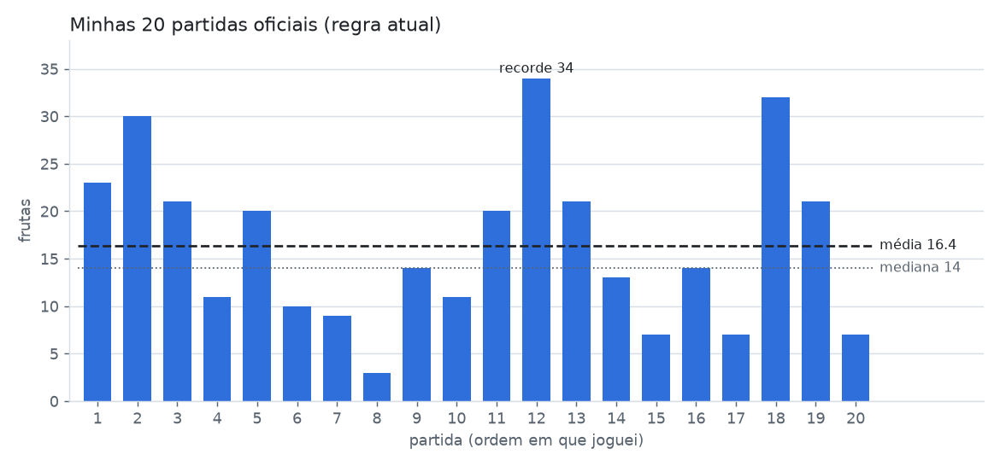
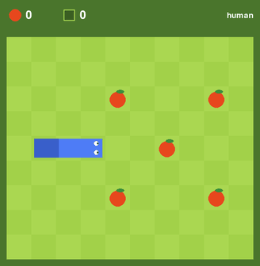

# Fase 2 — Versão jogável

> **Status:** concluída. Mateus jogou 20 partidas oficiais com a regra atual:
> **média 16,4 frutas, recorde 34.**

## O que foi feito

| Arquivo | Papel |
|---|---|
| `snake/render.py` | Desenha o jogo com pygame (só desenha: não lê teclado nem controla tempo) |
| `snake/replay.py` | Grava partidas como seed + ações; reproduz e confere |
| `scripts/play.py` | Você joga no teclado; toda partida terminada vira um replay em `replays/human/` |
| `scripts/human_stats.py` | Re-simula todos os replays; separa as 20 oficiais; gera gráfico e `docs/human_baseline.json` |
| `scripts/replay_to_gif.py` | Transforma um replay em GIF (base do vídeo da Fase 8) |
| `tests/test_replay_render.py` | Replays reproduzem a partida exata; desenho com as cores certas |


*Partida de exemplo de um jogador aleatório que só evita morrer no passo seguinte (12 frutas, 6 obstáculos).*

## Conceitos novos

### 1. Game loop: eventos → atualização → desenho

Todo jogo em tempo real é um laço infinito com três partes, repetido ~120 vezes por
segundo. É o mesmo padrão do `requestAnimationFrame` no JavaScript:

```python
while running:
    for event in pygame.event.get():   # 1) teclado/mouse (≈ addEventListener)
        ...
    while agora - ultimo_passo >= intervalo:
        game.step(acao)                # 2) o jogo anda (no ritmo de 7 passos/s)
    renderer.draw(screen, game)        # 3) desenha
    pygame.display.flip()              #    e mostra (≈ trocar o canvas)
```

Repare que **desenhar** (120x/s) e **andar** (7x/s) são ritmos diferentes. Assim a
tela fica fluida e o jogo não acelera em PC mais rápido.

### 2. Fila de comandos

Se você aperta ↑ e ← muito rápido, as duas teclas chegam entre dois passos. Sem
fila, só a última valeria e a cobra faria meia-volta (ignorada) ou perderia a
curva. Com a fila (`deque`), cada passo consome **um** comando:

```
Andando →. Você aperta ↑ e ← quase juntos.
fila = [↑, ←]
passo 1: usa ↑  -> fila = [←]
passo 2: usa ←  -> fila = []
```

### 3. Replay = seed + ações

Como o motor é determinístico, não precisamos gravar vídeo. Exemplo real:

```json
{
  "seed": 11,
  "actions": [null, null, null, null, null, null, null],
  "result": {"fruits": 1, "steps": 7, "end_reason": "wall", ...}
}
```

`null` = "não apertou nada, manteve a direção". Para assistir de novo, criamos
`SnakeGame(seed=11)` e repetimos as 7 ações: a partida sai idêntica, inclusive as
frutas e os obstáculos sorteados. O `human_stats.py` faz isso com **todos** os
replays e confere se o resultado bate com o gravado.

### 4. Separar desenho e regras

O `render.py` recebe um `SnakeGame` e só pinta. Por isso o mesmo código serve
para: você jogar, assistir a um replay, gerar GIF (sem janela, com
`SDL_VIDEODRIVER=dummy`) e, depois, assistir aos agentes.

## Como rodar

```powershell
.venv\Scripts\python.exe scripts\play.py                 # jogar (padrão: 7 passos/s)
.venv\Scripts\python.exe scripts\play.py --speed 5       # mais devagar
.venv\Scripts\python.exe scripts\human_stats.py          # suas estatísticas
.venv\Scripts\python.exe scripts\play.py --replay replays\human\ARQUIVO.json   # assistir
.venv\Scripts\python.exe scripts\replay_to_gif.py replays\human\ARQUIVO.json docs\media\minha.gif
```

Controles: setas ou WASD; a cobra só começa a andar no 1º toque. Espaço/P pausa,
Enter recomeça depois de perder, Esc sai.

## Resultados

### As 20 partidas oficiais

Oficiais = as 20 primeiras partidas jogadas com a regra atual (com a proibição de
becos sem saída, seção 4.5), em ordem cronológica. Os números saem da
re-simulação dos replays, não de anotação: as 45 partidas gravadas reproduzem
exatamente o resultado salvo.

| Métrica | Valor |
|---|---|
| Média de frutas | **16,40** |
| Mediana | 14 |
| Recorde | **34** (232 passos, 16 obstáculos, cobra com 37 células) |
| Desvio padrão | 8,64 |
| Tabuleiro preenchido | média 21,6% · máx 41,1% |
| Vitórias | 0 (0%) |
| Como terminou | obstáculo 17 · parede 3 · corpo 0 |



Esses números ficam salvos em `docs/human_baseline.json`, que a tabela da Fase 3
vai ler. Com eles, as metas do projeto ficam concretas:

- **M1:** o agente precisa ter média acima de **16,4** frutas.
- **M2:** o agente precisa passar de **34** frutas com frequência.

### A partida recorde



No fim dela o tabuleiro estava assim (`H` cabeça, `o` corpo, `*` fruta, `#` obstáculo):

```
...#..#..#
.#.Hoooooo
...#*#*#.o
...ooooooo
#.#ooo#.*.
....#ooo.#
..#*..#oo.
.o.*oooooo
#oooo#.ooo
```

A cobra vinha pela linha 1 para a esquerda, com a cabeça em (1,3). No último passo
você apertou ↑, e a cabeça foi para (0,3), onde há um obstáculo. Seguindo reto,
a cobra teria chegado a (1,2), que estava livre. Para assistir à partida:

```powershell
.venv\Scripts\python.exe scripts\play.py --replay replays\human\20261118-002744_seed1426620528.json
```

### O que os números dizem

1. **Obstáculos são o grande vilão:** 17 das 20 mortes. Nenhuma foi no próprio
   corpo: com no máximo 37 células, a cobra ainda é curta para se enrolar num
   tabuleiro de 90.
2. **A variação é enorme:** de 3 a 34 frutas na mesma pessoa e nas mesmas regras.
   Por isso precisamos de muitas partidas (e das mesmas 1.000 sementes) para
   comparar agentes. Veja o conceito 5, abaixo.
3. **Comparação com o jogador aleatório "seguro" da Fase 1** (só evita morrer no
   passo seguinte): 7,46 frutas de média. Você faz o dobro. O primeiro agente
   "inteligente" já precisa superar isso.
4. **Regra antiga x atual:** nas 24 partidas com a regra antiga sua média foi 10,79
   (recorde 31). A subida para 16,4 mistura dois efeitos que não dá para separar:
   você praticou e a regra nova removeu os becos. Por isso só as partidas da regra
   atual valem como referência.
5. **Aprendizado durante a sessão:** as 10 primeiras oficiais deram 15,2 de média;
   as 10 últimas, 17,6. Diferença pequena perto da variação, então não dá para
   afirmar que você melhorou dentro da sessão.

### Conceito 5: quanto dá para confiar numa média de 20 partidas?

A média de 20 partidas varia de amostra para amostra. Uma medida simples dessa
incerteza é o **erro padrão** = desvio padrão ÷ √(número de partidas):

```
erro padrão = 8,64 / √20 = 8,64 / 4,47 ≈ 1,93
intervalo de ~95% ≈ média ± 2 × erro padrão = 16,4 ± 3,9  ->  de 12,5 a 20,3
```

Ou seja: se você jogasse outras 20 partidas, a média provavelmente cairia entre
~12,5 e ~20,3. Para os agentes avaliamos **1.000** partidas, então o erro padrão
deles fica uns 7 vezes menor (√1000 / √20 ≈ 7). Na prática: para dizer com
segurança que um agente bateu a M1, a média dele deve ficar bem acima de 16,4,
não só um pouquinho.

## O que deu errado e como foi resolvido

1. **Primeiro toque não começava o jogo.** Se a 1ª tecla fosse →, que já é a direção
   atual, ela não entrava na fila e o jogo continuava esperando. Agora qualquer seta
   começa.
2. **Replay em JSON gigante.** O `json.dumps` com indentação quebrava cada
   coordenada em várias linhas. Ações e configuração agora ficam numa linha só.
3. **Teste do `play.py` sem teclado.** Para testar o loop sem ninguém jogando,
   substituímos `pygame.event.get` por uma função que "aperta" teclas em quadros
   fixos, com a tela em modo `dummy`. As partidas simuladas foram gravadas e
   reproduzidas com o resultado idêntico.
4. **A regra mudou no meio da fase.** Jogando, você achou obstáculos que criavam
   becos sem saída. Criamos a regra 4.5 (ver `docs/diario.md`), e as 24 partidas já
   gravadas deixaram de valer como referência. Elas continuam reproduzíveis, porque
   os replays antigos rodam com `forbid_dead_ends=False`, mas o `human_stats.py`
   as separa das oficiais.
