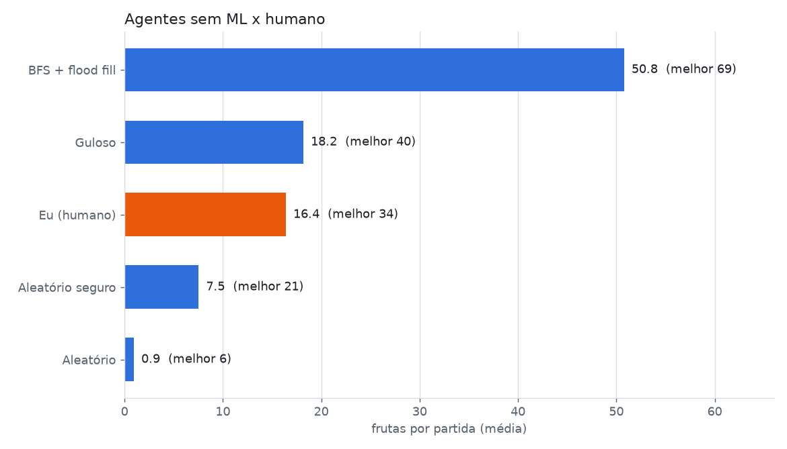
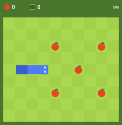

# Fase 3 — Baselines sem ML

> **Status:** concluída. Quatro agentes "programados à mão" foram avaliados nas
> mesmas 1.000 sementes e comparados com você. O melhor deles (BFS + flood fill)
> faz **50,8 frutas de média** e **zera o jogo em 1,8% das partidas**.

## O que foi feito

| Arquivo | Papel |
|---|---|
| `agents/simple.py` | Os 4 agentes: aleatório, aleatório seguro, guloso, BFS + flood fill |
| `agents/grid.py` | As "contas de mapa" dos agentes: BFS, flood fill, corpo depois de um caminho, cauda alcançável |
| `snake/evaluation.py` | As 1.000 sementes oficiais, jogar uma partida, resumir as métricas |
| `scripts/evaluate.py` | Avalia agentes, salva CSV/JSON/melhor replay, gera tabela e gráfico |
| `tests/test_agents.py` | 24 testes: sementes fixas, BFS, flood fill, armadilhas, reprodutibilidade |
| `experiments/fase3_baselines/` | Resultados: `summary.json`, `tabela.md`, um CSV por agente, melhores replays |

### Os 4 agentes

| Agente | Como decide | Analogia |
|---|---|---|
| **Aleatório** | Sorteia uma das 4 direções | Apertar teclas de olhos fechados |
| **Aleatório seguro** | Sorteia entre as direções que não matam no próximo passo | Olhar só 1 casa à frente |
| **Guloso** | Vai para a direção segura que mais aproxima de uma fruta (distância "em linha reta" pela grade) | Correr atrás da comida sem pensar no depois |
| **BFS + flood fill** | Menor caminho real até uma fruta, **só se depois de comer ainda der para alcançar a própria cauda** | Planejar o caminho e checar se não vai se encurralar |

**Regra de ouro (seção 9 da especificação):** todo agente só *consulta* o jogo
(`game.get_state()` e `game.safe_directions()`) e devolve uma direção. Ele nunca
chama `game.step()` nem olha o gerador aleatório do jogo. Um teste garante isso:
o estado e o gerador do jogo são idênticos antes e depois de `agent.act(game)`.

## Conceitos novos

### 1. BFS (busca em largura), passo a passo

A BFS acha o **menor caminho** num mapa explorando em "ondas": primeiro tudo a 1
passo, depois tudo a 2, e assim por diante. Exemplo num pedaço do tabuleiro
(`H` cabeça, `#` obstáculo, `*` fruta):

```
. . . .        onda 0: H
. H # *        onda 1: as vizinhas livres de H        -> (0,1), (2,1), (1,0)
. . . .        onda 2: as vizinhas livres da onda 1   -> (0,2), (2,2), (0,0), (2,0)
               onda 3: ... -> (0,3), (2,3)
               onda 4: ... -> (1,3) = fruta! caminho de 4 passos, contornando o #
```

Como cada célula é visitada pela primeira vez na onda mais cedo possível, o caminho
encontrado é sempre o mais curto. No código, as ondas são uma **fila** (`deque`):
quem entra primeiro sai primeiro, como `array.push()` + `array.shift()` no JS.

### 2. O corpo anda junto

Uma armadilha da BFS ingênua: tratar o corpo inteiro como parede. Só que, a cada
passo, a cauda sai do lugar. Exemplo: cobra de 4 células, com a cauda logo acima da
cabeça e uma fruta acima da cauda:

```
* .      <- fruta
o o      <- a cauda (esquerda) sai no 1º passo
H o      <- cabeça
```

Contando o corpo como parede, a fruta pareceria inalcançável. A regra certa é: a
célula do corpo de índice `i` (cabeça = 0) está livre depois de `len(corpo) - i`
passos. Aqui a cauda tem índice 3 e o corpo tem 4 células, então ela está livre
já no passo 1. Isso está em `bfs_paths_to_fruits` e tem um teste com este desenho.

### 3. Flood fill e o teste "alcanço minha cauda?"

Flood fill é o "balde de tinta": espalha a partir de uma célula até bater em algo.
Serve para medir **quanto espaço sobra**.

O agente BFS usa uma ideia mais forte: antes de ir comer, ele **imagina a cobra
depois de comer** (`body_after_path`) e pergunta se de lá a cabeça alcança a cauda.
Se alcança, a cobra nunca está presa: no pior caso ela segue a própria cauda, que
vai abrindo espaço. Exemplo do teste `test_bfs_refuses_fruit_that_traps_it`:

```
col:      2 3 4 5 6 7 8 9
linha 0:  . . . . . # . *     a fruta está num bolsão de 3 casas
linha 1:  o o o o o o H .
linha 2:  . . . . . . . #
```

O guloso iria para cima, atrás da fruta, e ficaria preso no bolsão. O BFS simula:
"comi em (0,9); minha cauda está em (1,3); da cabeça só alcanço (1,9), que não leva
a lugar nenhum". Plano recusado. Ele desce em direção às outras frutas.

Se nenhum plano é seguro, entra o **modo sobrevivência**: entre as direções que não
matam já, escolhe a que mantém a cauda alcançável e deixa mais espaço livre.

### 4. A mesma prova para todos: sementes fixas

`eval_seeds()` gera sempre as mesmas 1.000 sementes, a partir de uma semente-mestra
fixa (`20261118`). Cada agente joga exatamente as mesmas 1.000 partidas, com os
mesmos sorteios de frutas e obstáculos. O `summary.json` guarda uma "impressão
digital" das sementes (`158f340ed1ca`). Se algum dia ela mudar, a prova mudou e os
números deixam de ser comparáveis.

### 5. Mesma "interface" para todos os agentes (duck typing)

Todo agente tem dois métodos: `reset(seed)` e `act(game)`. O `evaluate.py` não quer
saber qual é o agente; só chama esses dois. Em JavaScript seria igual: várias classes
com os mesmos métodos. Os agentes de RL das próximas fases vão seguir o mesmo
formato, e o `evaluate.py` vai avaliá-los sem mudar nada.

## Como rodar

```powershell
.venv\Scripts\python.exe scripts\evaluate.py                       # os 4 agentes, 1.000 partidas cada (~80 s)
.venv\Scripts\python.exe scripts\evaluate.py --agents greedy bfs   # só alguns
.venv\Scripts\python.exe scripts\evaluate.py --games 100           # teste rápido
.venv\Scripts\python.exe scripts\play.py --replay experiments\fase3_baselines\replays\bfs_best.json   # assistir à vitória
.venv\Scripts\python.exe -m pytest tests\test_agents.py            # testes da fase
```

## Resultados

Agentes: 1.000 partidas cada, nas sementes oficiais. Humano: suas 20 partidas
oficiais da Fase 2.

| Jogador | Partidas | Média | Mediana | Melhor | % tabuleiro (média / máx) | Vitórias | Como terminou |
|---|---:|---:|---:|---:|---:|---:|---|
| Aleatório | 1000 | 0,94 ± 0,06 | 1 | 6 | 4,4% / 10,0% | 0% | parede 89%, obstáculo 6%, corpo 5% |
| Aleatório seguro | 1000 | 7,53 ± 0,22 | 7 | 21 | 11,7% / 26,7% | 0% | corpo 52%, parede 33%, obstáculo 15% |
| **Eu (humano)** | 20 | 16,40 ± 3,86 | 14 | 34 | 21,6% / 41,1% | 0% | obstáculo 85%, parede 15% |
| Guloso | 1000 | 18,18 ± 0,42 | 18 | 40 | 23,5% / 47,8% | 0% | corpo 50%, obstáculo 41%, parede 9% |
| **BFS + flood fill** | 1000 | **50,78 ± 0,74** | 53 | 69 | 59,8% / 80,0% | **1,8%** | tempo 83%, obstáculo 8%, corpo 6%, vitória 2%, parede 1% |

*± = 2 erros padrão (intervalo de ~95% para a média; veja o conceito 5 da Fase 2).*



### Uma vitória do BFS (69 frutas em 297 passos)



### O que os números dizem

1. **O guloso empata com você.** A média dele (18,2) fica acima da sua (16,4), mas
   dentro da sua margem de ±3,9. Ele morre quase sempre no próprio corpo ou em
   obstáculos (91%), porque não pensa no depois. Passou de 34 frutas (seu recorde)
   em só 17 das 1.000 partidas.
2. **O BFS joga em outro nível:** 50,8 de média, acima de 34 em 884 das 1.000
   partidas e **18 vitórias**. Isso mostra que o jogo é zerável e mede o tamanho do
   desafio: com só 2 regras (menor caminho + não se encurralar), um programa
   simples já ganha às vezes.
3. **Por que o BFS termina por "tempo" (83%)?** Nessas partidas ele não está
   perdido: está no fim do jogo. Na média ele comeu 54,4 frutas e só restavam ~10
   células vazias. As frutas restantes estão em bolsões, e comer qualquer uma
   tornaria a cauda inalcançável. Então ele dá voltas seguindo a cauda até estourar
   o limite de 200 passos sem comer. Jogar esse final é o desafio da Fase 7.
4. **Por que o BFS ainda morre em obstáculo (8%)?** Ele não sabe onde vai nascer o
   próximo obstáculo. Um obstáculo novo pode fechar o caminho até a cauda depois que
   ele já se comprometeu, e aí não sobra direção segura.

### O que isso muda nas próximas fases

- **M1** (média acima de 16,4) e **M2** (passar de 34 com frequência) do CLAUDE.md
  já são batidas por um programa sem ML. Para o RL ser interessante, a régua real
  passa a ser o **BFS (50,8)** e a **taxa de vitória (1,8%)**.
- O critério da Fase 5 ("o DQN supera o guloso") significa média acima de 18,2.
  O BFS fica como o adversário a ser batido nas Fases 6 e 7.

## O que deu errado e como foi resolvido

1. **83% de "tempo" no BFS.** Tentei duas correções, medidas nas 100 primeiras
   sementes oficiais:
   - *Aceitar comer se sobrar espaço ≥ tamanho da cobra, quando não houver plano
     seguro:* nenhuma mudança (51,3 → 51,4 frutas). Nesses finais, nem esse teste
     mais fraco passa.
   - *Tornar o teste da cauda "com tempo"* (contar que o corpo vai liberando
     células): **piorou** (51,3 → 49,4 frutas, e as mortes subiram de 15% para 52%).
     Seguir a cauda só é garantido com o teste estrito.

   Fiquei com a versão original e documentei a limitação. As duas tentativas estão
   no diário.
2. **Testes escritos às pressas.** Dois testes do BFS começaram com desenhos de
   tabuleiro confusos e uma asserção sem efeito (`... or True`). Reescrevi antes de
   rodar, com o desenho conferido célula por célula.
3. **GIF grande.** A vitória tem 298 quadros: o GIF ficou com 3,5 MB. Com
   `--scale 0.45` caiu para 2,9 MB.
