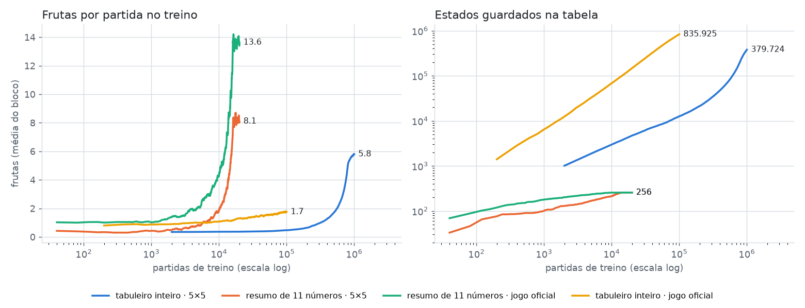

# Fase 4 — RL em miniatura (Q-learning com tabela)

> **Status:** concluída. O jogo ganhou a interface padrão de RL (Gymnasium) e um
> agente de Q-learning aprendeu a jogar do zero, só com recompensas. Com o
> tabuleiro inteiro como estado, ele aprende no 5×5 (0,34 → 7,38 frutas), mas a
> tabela explode no jogo oficial: 836 mil estados e 358 MB, e mesmo assim, em 56%
> dos passos da avaliação, ele cai num estado que nunca viu.

## O que foi feito

| Arquivo | Papel |
|---|---|
| `snake/gym_env.py` | `SnakeEnv`: o jogo no formato Gymnasium (`reset`/`step`), 2 tipos de observação, recompensas, máscara de ações |
| `snake/boards.py` | Tabuleiros por nome: `full` (oficial) e `mini` (5×5, 1 fruta, sem obstáculos) |
| `agents/qlearning.py` | Agente de Q-learning com tabela (dicionário estado → 4 notas) |
| `scripts/train_qlearning.py` | Treina, salva curva, marcos e checkpoints, e avalia nas 1.000 sementes oficiais |
| `scripts/plot_qlearning.py` | Gráfico comparando os 4 experimentos |
| `scripts/evaluate.py` | Ganhou `--board mini`, para comparar com os agentes da Fase 3 no 5×5 |
| `tests/test_gym_qlearning.py` | 16 testes: verificador oficial do Gymnasium, recompensas, observações, conta do Q-learning à mão |

**Mudança no motor (com testes primeiro):** o 5×5 "sem obstáculos" pedido no
CLAUDE.md precisou de uma opção nova, `GameConfig.spawn_obstacles` (padrão `True`).
A especificação (seção 11) proíbe mudar a frequência de obstáculos. Por isso a opção
só *desliga tudo* num tabuleiro de treino; o jogo oficial, as avaliações e as
partidas humanas continuam iguais. Antes de implementar, escrevi 2 testes: o padrão
continua gerando obstáculos e, com `False`, 300 partidas não geram nenhum. Eles
falharam primeiro e passaram depois.

**Hardware:** Ryzen 5 5600X (6 núcleos, 12 threads), 16 GB de RAM e uma RTX 2060
SUPER com 8 GB. A tabela roda só na CPU; a GPU entra na Fase 5. Os 4 experimentos
rodaram em paralelo, cada um num núcleo; o mais longo levou 5 min 16 s.

## Conceitos novos

### 1. A interface Gymnasium

Gymnasium é a "tomada padrão" do RL: se o jogo tem esse formato, qualquer biblioteca
de RL o entende. Uma partida inteira fica assim:

```python
env = SnakeEnv(BOARDS["mini"], obs_type="features")
obs, info = env.reset(seed=42)
done = False
while not done:
    action = agente.escolhe(obs)                        # 0 cima, 1 direita, 2 baixo, 3 esquerda
    obs, reward, terminated, truncated, info = env.step(action)
    done = terminated or truncated
```

| Acontecimento | `reward` | `terminated` | `truncated` |
|---|---:|---|---|
| Andou sem comer | 0 | não | não |
| Comeu uma fruta | +1 | não | não |
| Bateu (parede, corpo, obstáculo) | −1 | **sim** | não |
| Zerou o jogo | +1 +10 | **sim** | não |
| 200 passos sem comer (50 no 5×5) | 0 | não | **sim** |

**`terminated` x `truncated`:** morrer é um fim "de verdade": dali para frente, não
há mais recompensa. O limite de tempo é um corte externo: a cobra estava viva e
poderia continuar. Na conta do Q-learning (abaixo), o futuro só vale 0 quando
`terminated`. Se o tempo esgotado contasse como morte, o agente aprenderia que
"ficar vivo dando voltas" é ruim, o que não é verdade.

### 2. Q-learning, passo a passo

A tabela guarda uma nota `Q[estado][ação]`: quanta recompensa o agente espera juntar
dali para frente. Depois de cada passo, ele corrige a nota:

```
Q[s][a]  +=  alpha × ( recompensa + gamma × melhor nota do próximo estado − Q[s][a] )
```

Exemplo resolvido (é o `test_q_update_by_hand`), com alpha = 0,5 e gamma = 0,9:

```
Nota atual de (s, direita):              0
O agente vai para a direita e come:      recompensa = 1
Notas do próximo estado s':              [0; 2; 0; 0]  -> a melhor é 2

alvo  = 1 + 0,9 × 2 = 2,8
erro  = 2,8 − 0 = 2,8
nova  = 0 + 0,5 × 2,8 = 1,4
```

Se a partida tivesse terminado (morte), o alvo seria só a recompensa (sem o futuro).
Com −1, a nota ficaria 0 + 0,5 × (−1 − 0) = −0,5.

### 3. Explorar x aproveitar (epsilon-greedy)

No começo a tabela está vazia; escolher sempre "a melhor nota" não ensinaria nada.
Por isso, com probabilidade **epsilon**, o agente sorteia uma ação (explora); no resto
do tempo, usa a melhor nota (aproveita). Epsilon cai em linha reta de 1,0 (100%
sorteio) até 0,05 nos primeiros 80% do treino. Na avaliação, epsilon = 0.

É por isso que a curva de treino fica abaixo da avaliação final: no treino, 5% das
jogadas ainda são sorteadas.

### 4. O que é "o estado"? Duas escolhas

**a) O tabuleiro inteiro** (`obs_type="grid"`): 4 "camadas" 0/1 (cabeça, corpo, frutas,
obstáculos). Para a tabela, cada arrumação diferente é um estado diferente.

**b) Um resumo de 11 números** (`obs_type="features"`):

```
perigo à frente, à direita, à esquerda            (3)
direção atual (cima, direita, baixo, esquerda)    (4)
fruta mais próxima: acima, abaixo, esq., dir.     (4)
```

O resumo tem no máximo 288 combinações. O agente encontrou 256 delas, **tanto no
5×5 quanto no jogo oficial**, porque o resumo não depende do tamanho do tabuleiro.
Veja 3 linhas da tabela aprendida no jogo oficial (ordem das notas: cima, direita,
baixo, esquerda):

| Situação (andando para a direita) | cima | direita | baixo | esquerda* | Escolhe |
|---|---:|---:|---:|---:|---|
| Fruta acima e à direita, sem perigo | 2,11 | **2,51** | 2,02 | 2,35 | direita |
| Fruta à direita, **perigo à frente** | 1,47 | −0,89 | **2,08** | −0,85 | baixo |
| Fruta acima, perigo à frente e acima | −0,27 | −0,41 | **1,36** | −0,47 | baixo |

\* "esquerda" andando para a direita é meia-volta, que o jogo ignora: vale o mesmo
que seguir reto. Por isso a nota dela fica sempre perto da de "direita".

Ninguém programou "não bata": o agente aprendeu sozinho que seguir reto contra um
perigo vale cerca de −0,9.

### 5. Por que a tabela não escala

A tabela só sabe o que viu. Cada estado é aprendido **separadamente**: saber que
"bater na parede de cima com a cobra em L" é ruim não ensina nada sobre "bater na
parede de cima com a cobra em I". Quantos estados existem?

| Tabuleiro | Conta | Estados possíveis |
|---|---|---:|
| 5×5, só cabeça + 1 fruta | 25 × 24 | 600 |
| Oficial, só as 5 frutas | C(90, 5) | 43.949.268 |
| Oficial, cabeça + 5 frutas | 90 × C(89, 5) | 3,7 bilhões |
| Oficial, 16 obstáculos (só onde estão) | C(90, 16) | 2 × 10¹⁷ |

E isso sem contar o formato do corpo. Na prática, com 100 mil partidas de treino no
jogo oficial, a tabela guardou **835.925 estados (358 MB)**, e mesmo assim **56%** dos
passos da avaliação caíram em estados nunca vistos, em que o agente só pode chutar.

A saída é **generalizar**: em vez de uma linha da tabela por estado, uma *função*
que recebe o estado e calcula as notas, de modo que situações parecidas recebam
notas parecidas. O resumo de 11 números é uma forma manual e grosseira disso. Uma
rede neural é a forma automática: esse é o DQN da Fase 5.

## Como rodar

```powershell
# Os 4 experimentos desta fase
.venv\Scripts\python.exe scripts\train_qlearning.py --board mini --obs grid --episodes 1000000 --out fase4_q_grid_mini
.venv\Scripts\python.exe scripts\train_qlearning.py --board mini --obs features --episodes 20000 --out fase4_q_features_mini
.venv\Scripts\python.exe scripts\train_qlearning.py --board full --obs features --episodes 20000 --out fase4_q_features_full
.venv\Scripts\python.exe scripts\train_qlearning.py --board full --obs grid --episodes 100000 --out fase4_q_grid_full

# Agentes da Fase 3 no 5×5, para comparar
.venv\Scripts\python.exe scripts\evaluate.py --board mini --out fase4_baselines_mini

# Gráfico
.venv\Scripts\python.exe scripts\plot_qlearning.py
```

Cada experimento fica em `experiments/<nome>/`: `config.json` (parâmetros e seed),
`metrics.csv` (curva), `milestones.csv` (avaliação rápida em 0, 1 mil, 10 mil...),
`summary.json` (avaliação final) e `best_replay.json`. As tabelas ficam em
`checkpoints/`, que não vai para o Git (a maior tem 358 MB).

## Resultados

Todos avaliados nas mesmas 1.000 sementes oficiais, sem exploração (epsilon = 0).
Parâmetros iguais em todos: alpha 0,1, gamma 0,9, epsilon 1,0 → 0,05, seed 0.

### No 5×5 sem obstáculos

| Agente | Treino | Média | Melhor | Vitórias | Tabela | Estados nunca vistos | Como terminou |
|---|---|---:|---:|---:|---:|---:|---|
| Aleatório | — | 0,34 | 3 | 0% | — | — | parede 100% |
| Aleatório seguro | — | 3,53 | 14 | 0% | — | — | parede 51%, tempo 34% |
| Q-learning · tabuleiro inteiro | 1 milhão de partidas, 316 s | **7,38** | 11 | 0% | 379.724 | 3,8% | parede 67%, corpo 33% |
| Guloso | — | 10,71 | 22 | 0,8% | — | — | corpo 56%, parede 43% |
| Q-learning · resumo de 11 | 20 mil partidas, 11 s | **11,06** | 22 | 0,7% | 256 | 0% | corpo 64%, parede 35% |
| BFS + flood fill | — | 20,56 | 21 | 0% | — | — | tempo 100% |

### No jogo oficial (9×10, obstáculos)

| Agente | Treino | Média | Melhor | Tabela | Estados nunca vistos | Como terminou |
|---|---|---:|---:|---:|---:|---|
| Q-learning · tabuleiro inteiro | 100 mil partidas, 63 s | 1,80 | 5 | 835.925 (358 MB) | **55,9%** | parede 80% |
| Eu (humano, 20 partidas) | — | 16,40 | 34 | — | — | obstáculo 85% |
| Q-learning · resumo de 11 | 20 mil partidas, 38 s | **17,42** | 46 | 256 | 0% | corpo 59%, obstáculo 26% |
| Guloso | — | 18,18 | 40 | — | — | corpo 50%, obstáculo 41% |
| BFS + flood fill | — | 50,79 | 71 | — | — | tempo 84% |



*Esquerda: frutas por partida durante o treino (com exploração). Direita: estados
guardados na tabela. Os dois eixos x estão em escala log.*

### O que os números dizem

1. **O agente aprende** (critério da fase). No 5×5, com o tabuleiro inteiro, ele vai de
   0,34 frutas (igual ao aleatório) para 7,38, só com recompensas. Ninguém explicou
   as regras para ele.
2. **Mas aprende devagar e esquece de generalizar.** Precisou de 1 milhão de partidas e
   380 mil estados para chegar a 7,4. Ainda morre na parede em 67% das partidas: cada
   estado novo é um chute. Repare na curva azul: nada acontece até ~100 mil partidas.
3. **No jogo oficial, a tabela não serve.** 836 mil estados, 358 MB, 56% de estados
   novos na avaliação e 1,8 frutas de média. Mais treino não resolve: o número de
   estados é astronômico (conceito 5).
4. **O resumo de 11 números generaliza, mas é cego.** Com só 256 estados, aprende em
   segundos e quase empata com o guloso (17,4 x 18,2) no jogo oficial, passando a
   sua média. Mas ele só vê 1 casa ao redor da cabeça: não enxerga o formato do
   corpo nem becos mais adiante. Por isso a maioria das mortes é no próprio corpo
   (59%).
5. **Conclusão para a Fase 5:** o estado ideal seria o tabuleiro inteiro (que tem
   toda a informação), mas com algo que *generalize*. Isso é uma rede neural:
   primeiro com um vetor de características mais rico, depois com uma CNN lendo as
   camadas do tabuleiro (o formato `grid` daqui). A meta da fase é passar o guloso
   (18,18).

## O que deu errado e como foi resolvido

1. **Conflito entre a especificação e o plano.** A seção 11 proíbe mudar a frequência
   de obstáculos, e o CLAUDE.md pede um 5×5 sem obstáculos. Resolvi com uma opção que
   só desliga os obstáculos em tabuleiros de treino (padrão `True`), com testes
   provando que o jogo oficial não mudou. O comentário da `GameConfig` registra a
   exceção.
2. **Teste de "tempo esgotado" montado errado.** A cobra em quadrado 2×2 estava com a
   direção errada para o ciclo escolhido. Corrigi (direção e ordem das curvas) antes
   da primeira rodada.
3. **Checkpoint gigante.** A tabela do jogo oficial passou de 350 MB em 100 mil
   partidas. Os checkpoints já estavam fora do Git (`.gitignore`); só os CSV e JSON
   (poucos KB) são versionados.
4. **A curva azul engana no começo.** Até ~100 mil partidas, o agente "tabuleiro
   inteiro" parece não aprender nada. Não é bug: com epsilon alto, as jogadas são
   quase todas sorteadas, e a tabela ainda não viu os estados que importam. Por isso
   o treino salva avaliações sem exploração nos marcos (`milestones.csv`): 1,31 →
   1,83 → 2,44 → 7,36 frutas em 1 mil, 10 mil, 100 mil e 1 milhão de partidas.
