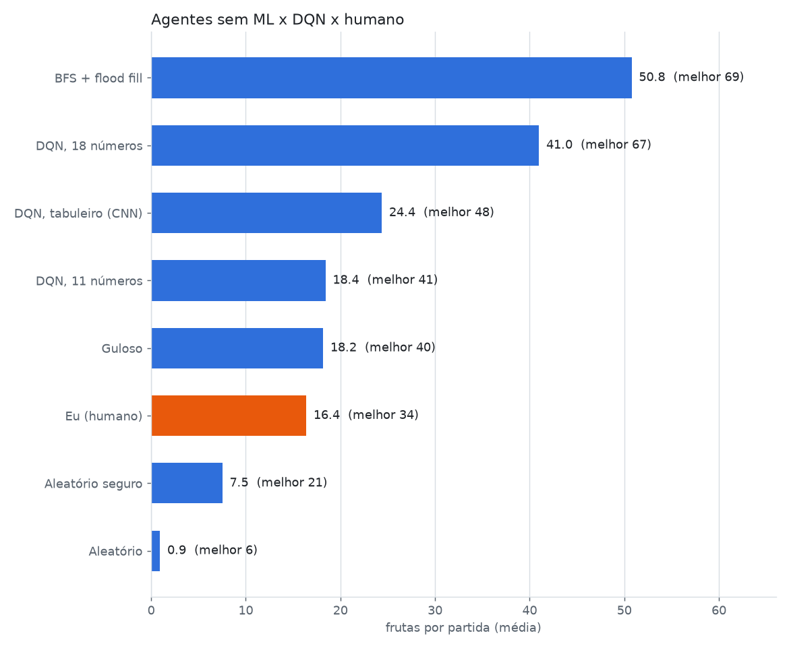
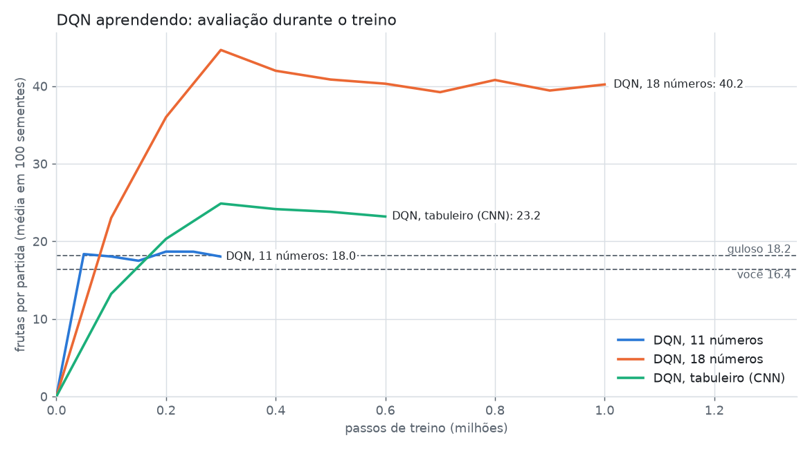
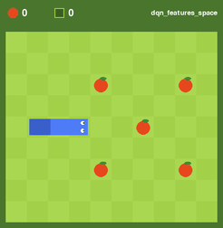

# Fase 5 — DQN do zero (PyTorch)

**Critério de conclusão:** o DQN supera o agente guloso (18,18 frutas).
**Resultado:** superou. Com 18 números de entrada, o DQN faz **40,99 frutas de média**
nas 1.000 sementes oficiais: mais que o dobro do guloso e 2,5× a minha média. Ele
passa do meu recorde (34) em 75% das partidas e ganhou 2 delas (0,2%).



## O que foi feito

| Arquivo | O que é |
|---|---|
| `agents/dqn.py` | As redes (`MLP` para vetores, `CNN` para o tabuleiro), o `ReplayBuffer` e o `DQNAgent` |
| `snake/gym_env.py` | Nova observação `features_space`: os 11 números da Fase 4 + 7 que "enxergam" o corpo |
| `scripts/train_dqn.py` | Treina por N passos, salva config, curvas, checkpoints e avalia nas 1.000 sementes |
| `scripts/evaluate.py` | Novo `--model nome=arquivo.pt`: avalia redes treinadas junto com os outros agentes |
| `scripts/plot_dqn.py` | Gráfico das curvas de aprendizado (`docs/media/fase5_dqn.png`) |
| `tests/test_dqn.py` | 10 testes: observação nova, buffer circular, passo de gradiente, mini-treino, salvar/carregar |
| `requirements.txt` | `torch` (instalado com CUDA 12.6 para a placa de vídeo) |

Hardware usado: Ryzen 5 5600X (CPU) para as redes pequenas, RTX 2060 SUPER (GPU) para a CNN.
Medi antes de treinar (30 mil passos): vetor na CPU 33 s; CNN na CPU 422 s; **CNN na GPU 51 s**.
A placa de vídeo deixou a CNN 8× mais rápida. Para as redes pequenas, a CPU basta: mandar um vetor de
18 números para a GPU custa mais do que a conta em si.

## Conceitos novos

### 1. Da tabela para a rede

Na Fase 4, Q era um dicionário: `q[estado] = [4 notas]`. Situação nova = chute.
Agora Q é uma **função com pesos ajustáveis**:

```
18 números  ->  [camada 128]  ->  [camada 128]  ->  4 notas (cima, direita, baixo, esquerda)
```

Cada "neurônio" de uma camada faz uma conta simples. Exemplo com 3 entradas:

```
entradas:  perigo_frente = 1,   espaço_frente = 0.05,   fruta_acima = 1
pesos:              -2.0                  3.0                  0.5        viés: 0.4
soma = 1×(-2.0) + 0.05×3.0 + 1×0.5 + 0.4 = -0.95
ReLU(-0.95) = 0      (ReLU: negativo vira 0, positivo passa igual)
```

A rede de 18 números tem **19.460 pesos** assim. Ninguém escolhe esses valores: o
treino ajusta. Duas situações parecidas (ex.: `espaço_frente` 0,05 e 0,06) dão somas
parecidas, logo notas parecidas. Isso é **generalizar**: a rede responde bem sobre
situações que nunca viu, coisa que a tabela não fazia.

Em JavaScript, a rede seria um objeto com arrays de pesos e um método `forward(x)`.
O PyTorch cuida do resto, inclusive de calcular como cada peso deve mudar.

### 2. Como a rede aprende: gradiente descendente

O alvo é o mesmo do Q-learning: `alvo = recompensa + gamma × melhor nota do próximo estado`.
A diferença é o que se corrige. Exemplo com um único peso `w` e uma previsão `Q = w × 2`:

```
w = 0.3 -> Q = 0.6, mas o alvo é 1.0 -> erro = 0.6 - 1.0 = -0.4
"se eu aumentar w um pouquinho, o erro diminui?" (é isso que o gradiente responde)
gradiente do erro² em relação a w = 2 × erro × 2 = -1.6
w_novo = w - lr × gradiente = 0.3 - 0.1 × (-1.6) = 0.46 -> Q = 0.92 (mais perto de 1.0)
```

`loss.backward()` calcula esse gradiente para os 19.460 pesos de uma vez, e
`optimizer.step()` dá o passinho. Usamos o otimizador **Adam** (um passinho "esperto",
que se adapta a cada peso) com `lr = 0.0005`, e o erro de **Huber** em vez do erro
quadrático puro: para erros grandes ele cresce em linha reta, e um alvo muito errado
não desmonta a rede.

### 3. Replay buffer: aprender com lotes sorteados

Se a rede aprendesse só com a última jogada, ela veria 50 passos seguidos do mesmo
corredor e "esqueceria" o resto. Então cada jogada vai para uma memória de 100 mil
posições (`ReplayBuffer`). A cada 4 passos de jogo, sorteamos **128 jogadas antigas
quaisquer** e treinamos com elas. Cada jogada é reaproveitada ~5 vezes, e o lote
mistura começo de partida, fim de partida, mortes e frutas.

A memória é **circular**: com capacidade 3 e jogadas 0, 1, 2, 3, 4, sobram 2, 3, 4
(o teste `test_replay_buffer_is_circular` confere exatamente isso).

### 4. Rede-alvo: um alvo que fica parado

O alvo usa a nota do próximo estado, que vem... da própria rede. Se a rede muda a cada
passo, o alvo muda junto. A solução: uma **cópia congelada** (`target_net`) calcula os
alvos e só é atualizada a cada 2.000 passos. É como estudar para uma prova cujo
gabarito só muda uma vez por semana, e não a cada pergunta.

### 5. Duas formas de "ver": números escolhidos x tabuleiro cru

**Vetor de 18 números (`features_space`).** Os 11 da Fase 4 mais 7 novos. Para cada
jogada possível (frente, direita, esquerda):

- `space_X`: depois de ir para X, qual fração do espaço livre a cabeça ainda alcança
  (o flood fill da Fase 3). Ex.: num corredor que vira beco, `space_direita = 0,05`.
- `tail_X`: depois de ir para X, a cabeça ainda alcança a cauda? (0 ou 1)

E `length`, o tamanho da cobra dividido pelo tabuleiro. **Esses números não dizem o
que fazer**, só entregam a informação. É o treino que descobre que 0,05 de espaço é
uma armadilha.

**Tabuleiro em 4 camadas + CNN.** A rede recebe o tabuleiro inteiro, (4, 9, 10): cabeça,
corpo, frutas, obstáculos. Uma **convolução 3×3** é um "carimbo" de 9 pesos que desliza
por todas as casas:

```
recorte 3×3 do canal "corpo"    carimbo (pesos aprendidos)    resultado nessa casa
  0 1 0                           0  1  0
  0 1 0           ×               0  1  0          =  1+1+1 = 3 ("corpo vertical aqui")
  0 1 0                           0  1  0
```

Com 32 e depois 64 carimbos diferentes, a rede aprende sozinha a detectar paredes,
cantos, corredores... Ninguém precisa programar o flood fill. Em troca, ela tem 1,5
milhão de pesos e muito mais a aprender.

## Como rodar

```powershell
# PyTorch com suporte à placa de vídeo (uma vez, ~2,5 GB)
.venv\Scripts\python.exe -m pip install torch --index-url https://download.pytorch.org/whl/cu126

# Os 3 experimentos desta fase (tempos medidos nesta máquina)
.venv\Scripts\python.exe scripts\train_dqn.py --obs features --steps 300000 --out fase5_dqn_features                       # 3 min
.venv\Scripts\python.exe scripts\train_dqn.py --obs features_space --steps 1000000 --eval-every 100000 --out fase5_dqn_space  # 13 min
.venv\Scripts\python.exe scripts\train_dqn.py --obs grid --device cuda --steps 600000 --eval-every 100000 --out fase5_dqn_cnn  # 15 min

# Comparação oficial (1.000 sementes) e gráficos
.venv\Scripts\python.exe scripts\evaluate.py --agents random safe_random greedy bfs --model dqn_11=experiments/fase5_dqn_features/model.pt dqn_18=experiments/fase5_dqn_space/model.pt dqn_cnn=experiments/fase5_dqn_cnn/model.pt --out fase5_comparacao --chart docs/media/fase5_comparacao.png --title "Agentes sem ML x DQN x humano"
.venv\Scripts\python.exe scripts\plot_dqn.py

# Assistir à vitória do DQN
.venv\Scripts\python.exe scripts\play.py --replay experiments\fase5_dqn_space\best_replay.json
```

Parâmetros comuns aos 3 experimentos: gamma 0,95; Adam lr 0,0005; buffer 100 mil; lote 128;
1 passo de gradiente a cada 4 passos de jogo; rede-alvo copiada a cada 2.000 passos;
10 mil passos aleatórios antes de treinar; epsilon de 1 a 0,02 nos primeiros 30% do treino;
seed 0; recompensas da Fase 4 (+1 fruta, −1 morte, +10 vitória). A única diferença entre eles
é a observação (e, com ela, a rede).

## Resultados

Todos nas mesmas 1.000 sementes oficiais (impressão digital `158f340ed1ca`), via `evaluate.py`:

| Jogador | Média de frutas | Mediana | Melhor | Vitórias | Partidas > 34 (meu recorde) | Como terminou |
|---|---:|---:|---:|---:|---:|---|
| Eu (humano, 20 partidas) | 16,40 | 14 | 34 | 0% | — | obstáculo 85%, parede 15% |
| Guloso | 18,18 ± 0,42 | 18 | 40 | 0% | 17 | corpo 50%, obstáculo 41% |
| Q-tabela, 11 números (Fase 4) | 17,42 | — | 46 | 0% | — | corpo 59% |
| **DQN, 11 números** | 18,43 ± 0,44 | 18 | 41 | 0% | 20 | corpo 62%, obstáculo 24% |
| **DQN, tabuleiro (CNN)** | 24,38 ± 0,42 | 25 | 48 | 0% | 59 | corpo 54%, obstáculo 32% |
| **DQN, 18 números** | **40,99 ± 0,64** | 41 | 67 | **0,2%** | **747** | corpo 40%, obstáculo 30%, tempo 18% |
| BFS + flood fill | 50,78 ± 0,74 | 53 | 69 | 1,8% | 884 | tempo 83% |

| Experimento | Pesos na rede | Treino | Partidas de treino | Dispositivo |
|---|---:|---:|---:|---|
| DQN, 11 números | 18.564 | 300 mil passos, 2,6 min | 7.713 | CPU |
| DQN, 18 números | 19.460 | 1 milhão de passos, 13 min | 18.861 | CPU |
| DQN, CNN | 1.532.452 | 600 mil passos, 14 min | 12.944 | GPU |



A melhor partida do DQN de 18 números é uma **vitória**: 67 frutas em 408 passos, com 16
obstáculos no mapa (seed 1421312602):



### O que os números dizem

1. **Rede x tabela com a mesma visão: empate.** Com os 11 números, o DQN (18,43) fica
   igual ao Q-tabela (17,42) e ao guloso (18,18). Faz sentido: os 11 números só têm
   256 combinações, e a tabela já cobria todas. A rede só ganha quando há situações
   demais para uma tabela. **O limite não era o algoritmo, era o que o agente vê.**
2. **O que o agente vê decide quase tudo.** Os mesmos 18 mil pesos, só com 7 números a
   mais sobre espaço e cauda, passam de 18,4 para 41,0 frutas. Mortes no corpo caem de
   62% para 40%, e aparecem fins por tempo (18%): a cobra prefere "dar voltas" a se
   arriscar, como o BFS no fim de jogo.
3. **A CNN aprende sozinha, mas devagar.** Vendo o tabuleiro cru, sem nenhuma dica, ela
   chegou a 24,4: acima do guloso e de mim, mas longe dos 18 números. Ela precisa
   descobrir sozinha o que o flood fill entrega pronto, com 80 vezes mais pesos, e não
   sabe qual ponta do corpo é a cauda (o canal "corpo" é igual em todas as células).
4. **Ainda abaixo do BFS** (50,78), que planeja caminhos inteiros. O DQN decide olhando
   1 passo à frente (mais o resumo de espaço). Fechar essa distância é o objetivo das
   Fases 6 e 7.
5. **Metas do CLAUDE.md:** M1 (média > 16,4) foi atingida pelos 3 DQNs. M2 (passar de 34
   com frequência) foi atingida pelo DQN de 18 números (75% das partidas). M3 ainda é 0,2%.

## O que deu errado e como foi resolvido

- **Instalação:** o `pip install torch` comum baixa a versão **só-CPU**. Para a placa de
  vídeo, é preciso o índice do PyTorch com CUDA (`--index-url .../cu126`). Ficou anotado
  no `requirements.txt`.
- **CNN na CPU era inviável:** 30 mil passos levaram 7 minutos, então 600 mil levariam
  2,3 horas. Na GPU levaram 14 minutos. Já as redes pequenas são mais rápidas na CPU,
  com 1 núcleo só (`torch.set_num_threads(1)`), o que permitiu treinar duas em paralelo.
- **O desempenho cai depois do pico (não resolvido).** As duas redes boas atingem o melhor
  ponto quando o epsilon termina de cair (18 números: 44,7 frutas em 300 mil passos) e
  depois oscilam um pouco abaixo (~40). A diferença é maior que o ruído da avaliação de
  100 sementes (±2,0, ou seja, 2 erros padrão). Hipóteses: quando a exploração para, o buffer passa a ter quase só
  partidas "do jeito atual" e a rede se especializa demais; ou a rede-alvo atualizada a
  cada 2.000 passos é rápida demais. Cada hipótese é um experimento separado (regra 4).
  O resultado oficial é o da rede **final**: escolher o melhor marco usando as sementes de
  avaliação seria "colar na prova".
- **Gráfico:** a legenda e os rótulos das linhas de referência se sobrepunham às curvas.
  Movi a legenda e pus os rótulos na ponta direita das linhas.
