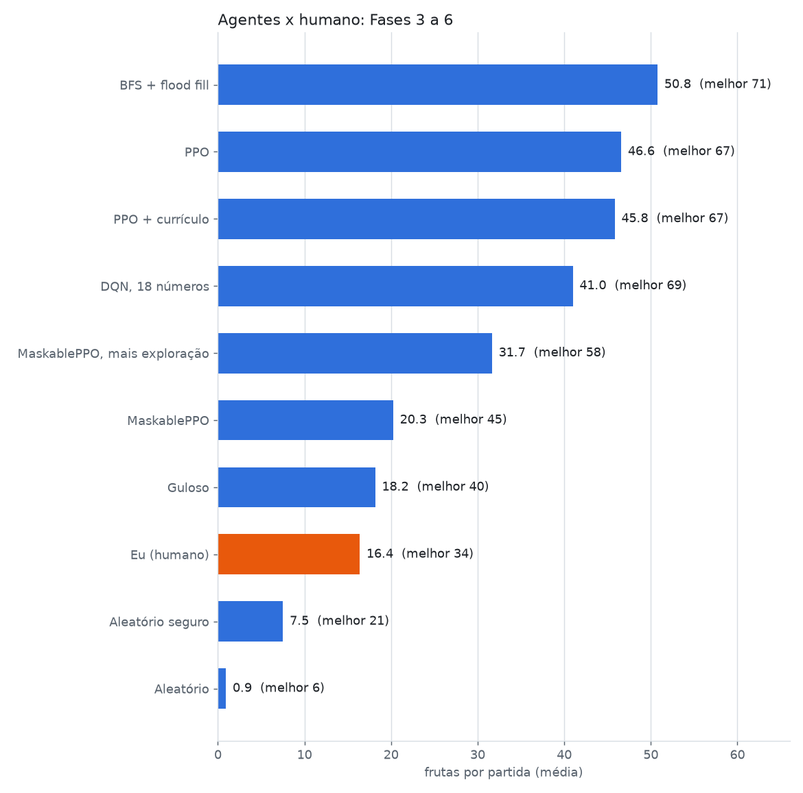
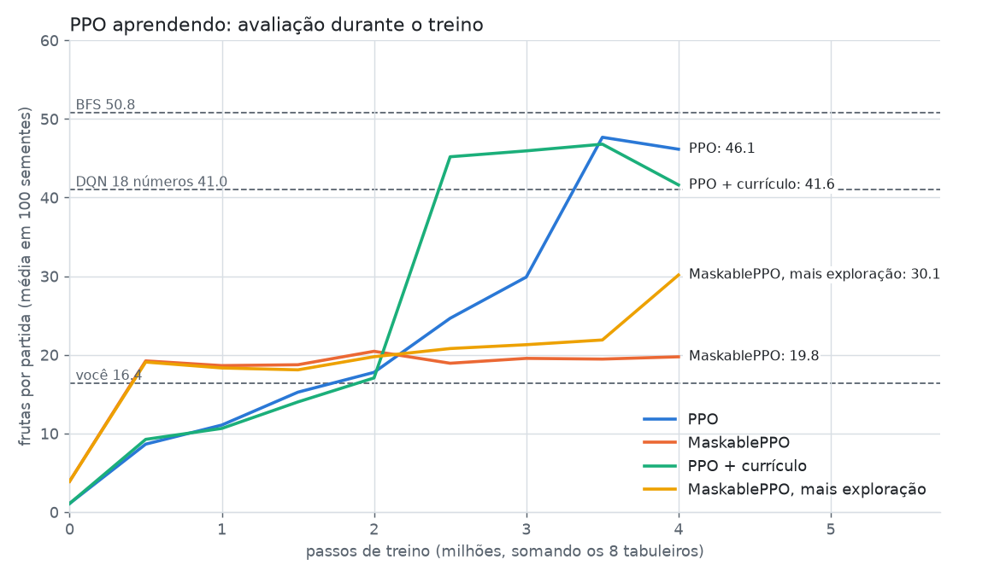
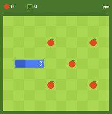

# Fase 6 — PPO (Stable-Baselines3)

**Critério de conclusão:** M1 e M2 atingidos.
**Resultado:** atingidos. O PPO faz **46,59 frutas de média** nas 1.000 sementes oficiais
(2,8× a minha média de 16,4, então M1 está batida). Ele passa do meu recorde de 34 em **851 das 1.000
partidas** (M2). É o melhor agente que aprendeu sozinho até agora: passa o DQN (41,00) e
fica a 4 frutas do BFS (50,79). Ninguém zera o jogo ainda (M3 = 0%).



## O que foi feito

| Arquivo | O que é |
|---|---|
| `agents/ppo.py` | `PPOAgent` (embrulha o modelo do SB3 na interface `reset`/`act`), hiperparâmetros padrão, `EnvFactory` |
| `scripts/train_ppo.py` | Treina PPO ou MaskablePPO com 8 tabuleiros em processos paralelos; opção `--curriculum` |
| `snake/curriculum.py` | Banco de situações avançadas tiradas de partidas do BFS em sementes de treino |
| `snake/gym_env.py` | `action_mask(game)` (máscara compartilhada por treino e avaliação) e `start_states` no `SnakeEnv` |
| `scripts/evaluate.py` | `--model nome=arquivo.zip` agora carrega PPO também |
| `scripts/plot_ppo.py` | Curvas de aprendizado (`docs/media/fase6_ppo.png`) |
| `tests/test_ppo.py` | 8 testes: máscara (inclusive com a cobra presa), agente mascarado nunca escolhe jogada mortal, mini-treino, salvar/carregar, currículo |
| `requirements.txt` | `stable-baselines3` e `sb3-contrib` 2.9.2 |

Hardware: só CPU (Ryzen 5 5600X). Os 8 tabuleiros rodam em 8 processos, a ~2.700 passos
por segundo somados. A rede é pequena (128 × 128), então a placa de vídeo não ajudaria.

## Conceitos novos

### 1. DQN aprende notas; PPO aprende a política direto

O DQN aprendia `Q(situação, ação)` e jogava a ação de maior nota. O PPO tem uma rede com
**duas cabeças**:

- **Ator (a política):** dá as probabilidades das 4 ações. Ex.: `[cima 0,70, direita 0,25, baixo 0,00, esquerda 0,05]`.
- **Crítico (o valor):** estima quanto a partida ainda vai render a partir daqui. Ex.: `V = 3,2` frutas.

O treino compara o que aconteceu com o que o crítico esperava. Isso se chama **vantagem**:

```
o crítico esperava 3,2; depois de "cima", a partida rendeu 4,0
vantagem = 4,0 - 3,2 = +0,8   -> "cima" foi melhor que o esperado: sobe a probabilidade de "cima"
se tivesse rendido 2,5:  vantagem = -0,7 -> desce a probabilidade de "cima"
```

### 2. O "Proximal": passos pequenos e seguros

Se a probabilidade de "cima" era 0,70, uma atualização só pode levá-la até ~0,84 (+20%)
ou ~0,56 (−20%), mesmo que a vantagem seja enorme. É o `clip_range = 0.2`. Sem esse freio,
um lote de partidas de sorte pode fazer a política "decorar" uma jogada ruim e desaprender
tudo. Com ele, o treino é lento mas estável.

### 3. Vários tabuleiros em paralelo, sem replay buffer

O PPO joga **8 partidas ao mesmo tempo**, cada uma num processo (`SubprocVecEnv`), por 512
passos cada. Isso dá um lote de 4.096 jogadas. Ele aprende com o lote (4 passadas) e **joga
o lote fora**. Diferente do DQN, que reaproveitava jogadas antigas: o PPO só aprende com
a política atual.

No Windows, cada processo novo reimporta o script. Por isso o `if __name__ == "__main__":`
no fim do `train_ppo.py` é obrigatório; sem ele, cada processo começaria outro treino.

### 4. Máscara de ações (MaskablePPO)

Antes de sortear, as jogadas que matam na hora recebem probabilidade 0:

```
rede:     [cima 0,40, direita 0,30, baixo 0,10, esquerda 0,20]
máscara:  [  sim  ,     NÃO    ,   sim   ,    sim     ]   (direita = parede)
final:    [cima 0,57, direita 0,00, baixo 0,14, esquerda 0,29]   (renormaliza para somar 1)
```

Um caso especial: se a cobra está presa e **nenhuma** jogada é segura, a máscara toda falsa
daria 0/0. Nesse caso liberamos todas (ela morre de qualquer jeito). Esse caso tem teste.

### 5. Entropia: o quanto a política "ainda duvida"

Entropia alta = probabilidades espalhadas (explora). Entropia baixa = quase sempre a mesma
ação (decidiu). O `ent_coef` é um bônus no treino por manter dúvida. Com pouco bônus, a
política pode "decidir" cedo demais e nunca descobrir uma estratégia melhor. Foi exatamente
o que aconteceu com o MaskablePPO (veja os resultados).

### 6. Currículo de inícios avançados

O gargalo de todos os agentes é o fim de jogo, mas uma partida leva centenas de passos para
chegar lá. Então montei um banco de **5.162 situações avançadas** (de 20 a 67 frutas, média
46,6), retiradas de 300 partidas do BFS em sementes de treino. No treino, **metade das
partidas começa numa delas** em vez do início oficial. Daí em diante quem joga é o PPO.
A avaliação sempre começa do início oficial, e as sementes do banco nunca são as de avaliação.

## Como rodar

```powershell
.venv\Scripts\python.exe -m pip install stable-baselines3 sb3-contrib

# Os 4 experimentos (tempos nesta máquina)
.venv\Scripts\python.exe scripts\train_ppo.py --steps 4000000 --out fase6_ppo                                  # 15 min
.venv\Scripts\python.exe scripts\train_ppo.py --masked --steps 4000000 --out fase6_maskppo                     # 20 min
.venv\Scripts\python.exe scripts\train_ppo.py --curriculum --steps 4000000 --out fase6_ppo_cur                 # 15 min
.venv\Scripts\python.exe scripts\train_ppo.py --masked --ent-coef 0.05 --steps 4000000 --out fase6_maskppo_ent # 20 min

# Comparação oficial (1.000 sementes, ~10 min) e gráficos
.venv\Scripts\python.exe scripts\evaluate.py --agents random safe_random greedy bfs --model dqn_18=experiments/fase5_dqn_space/model.pt ppo=experiments/fase6_ppo/model.zip maskppo=experiments/fase6_maskppo/model.zip ppo_cur=experiments/fase6_ppo_cur/model.zip maskppo_ent=experiments/fase6_maskppo_ent/model.zip --out fase6_comparacao --chart docs/media/fase6_comparacao.png --title "Agentes x humano: Fases 3 a 6"
.venv\Scripts\python.exe scripts\plot_ppo.py

# Assistir à melhor partida do PPO
.venv\Scripts\python.exe scripts\play.py --replay experiments\fase6_comparacao\replays\ppo_best.json
```

Parâmetros comuns: observação de 18 números (Fase 5); rede 128 × 128 (ator e crítico);
lr 0,0003; 8 tabuleiros × 512 passos por lote; lote de gradiente 512; 4 passadas; gamma 0,99;
GAE 0,95; clip 0,2; `ent_coef` 0,01; seed 0; recompensas da Fase 4; 4 milhões de passos.
Cada experimento muda **uma** coisa em relação ao seu ponto de partida:

| Experimento | Mudança | Comparar com |
|---|---|---|
| `fase6_ppo` | (ponto de partida) | — |
| `fase6_maskppo` | + máscara de ações | `fase6_ppo` |
| `fase6_ppo_cur` | + currículo (50% das partidas começam avançadas) | `fase6_ppo` |
| `fase6_maskppo_ent` | `ent_coef` 0,01 → 0,05 | `fase6_maskppo` |

## Resultados

Mesmas 1.000 sementes oficiais (`158f340ed1ca`), via `evaluate.py`:

| Jogador | Média | Mediana | Melhor | Partidas > 34 | Como terminou | Treino |
|---|---:|---:|---:|---:|---|---|
| Eu (20 partidas) | 16,40 | 14 | 34 | — | obstáculo 85%, parede 15% | — |
| Guloso | 18,18 ± 0,42 | 18 | 40 | 17 | corpo 50%, obstáculo 41% | — |
| MaskablePPO | 20,26 ± 0,46 | 20 | 45 | 33 | corpo 69%, obstáculo 27% | 20 min |
| MaskablePPO, mais exploração | 31,67 ± 0,64 | 32 | 58 | 408 | corpo 55%, obstáculo 36% | 20 min |
| DQN, 18 números (Fase 5) | 41,00 ± 0,64 | 41 | 69 | 747 | corpo 40%, obstáculo 30%, tempo 18% | 13 min |
| PPO + currículo | 45,84 ± 0,74 | 48 | 67 | 851 | tempo 86%, obstáculo 7% | 14 min |
| **PPO** | **46,59 ± 0,74** | **49** | 67 | **851** | tempo 83%, corpo 10% | 15 min |
| BFS + flood fill | 50,79 ± 0,74 | 53 | 71 | 884 | tempo 84%, obstáculo 8% | — |

Vitórias: 0% para todos.



A melhor partida do PPO: 67 frutas em 615 passos, com 15 obstáculos. Ela termina com o
tabuleiro **sem nenhuma célula vazia**, só cobra, obstáculos e 5 frutas. A cobra dá voltas
até o limite de tempo porque comer qualquer fruta a encurralaria:



### O que os números dizem

1. **O PPO aprende "em degrau".** Até 3 milhões de passos ele fica abaixo do DQN (30
   frutas). Entre 3 e 3,5 milhões, as partidas de treino saltam de 122 para 436 passos:
   ele descobre que dar voltas em segurança (seguindo a própria cauda) vale mais do que
   arriscar, e a média pula para 47. Daí em diante termina como o BFS: 83% por tempo, no
   fim de jogo.
2. **A máscara atrapalhou (de início).** Parecia que ajudaria: em 500 mil passos o
   MaskablePPO já fazia 19 frutas, enquanto o PPO fazia 9. Mas ele travou aí por 3,5
   milhões de passos, comendo como o guloso. A entropia caiu de 0,15 para 0,05: a política
   "decidiu" cedo demais. Uma explicação: sem poder errar o óbvio, quase toda morte vira
   "encurralado muitos passos depois", e fica difícil para a rede descobrir qual decisão
   antiga causou aquilo.
3. **Mais exploração confirma em parte.** Com `ent_coef` 0,05, a entropia ficou em 0,2–0,3
   e, no fim, o MaskablePPO começou a sair do platô (22 → 30 frutas nos últimos 500 mil
   passos; 31,67 na avaliação final). Ainda estava subindo: com mais passos, talvez dê o
   mesmo "degrau" do PPO. Fica para a Fase 7.
4. **O currículo antecipou o aprendizado, mas não melhorou o final.** O degrau veio com
   2,5 milhões de passos em vez de 3,5 milhões. Mas a média final ficou igual (45,84 contra
   46,59; os intervalos se cruzam). Ver mais fins de jogo não ensinou a comer as últimas
   frutas: com a recompensa atual, dar voltas até o tempo acabar custa 0, e arriscar pode
   custar −1. Para o agente, "não arriscar" é racional.
5. **M1 e M2 batidas, M3 não.** Todos os bons agentes (BFS, PPO, DQN) param no mesmo
   lugar: tabuleiro quase cheio, frutas em bolsões, cobra dando voltas. Zerar exige
   **planejar** a ordem de comer as últimas frutas, e não só evitar a morte. Esse é o
   tema da Fase 7 (rede + busca).

## O que deu errado e como foi resolvido

- **Máscara toda falsa.** Com a cobra presa, nenhuma ação é segura, e o MaskablePPO
  quebraria (probabilidades 0/0). Teste escrito antes; agora a máscara libera todas as
  ações nesse caso.
- **Memória do computador.** O sistema encerrou um treino em segundo plano por falta de
  memória (dois treinos em sequência, com outros programas abertos). O PPO + currículo já
  tinha terminado. O MaskablePPO com mais exploração foi reiniciado do zero e terminou
  normalmente.
- **Nomes errados no gráfico.** A comparação rodou antes de eu cadastrar os nomes de dois
  experimentos. Refiz a tabela e o gráfico a partir do `summary.json`, sem reavaliar.
- **Métricas de treino com currículo.** Partidas que começam avançadas já "nascem" com
  20–67 frutas, então a curva de treino do `fase6_ppo_cur/metrics.csv` fica inflada. Por
  isso as comparações usam sempre a avaliação nas sementes oficiais (`milestones.csv` e
  `evaluate.py`), que começa do início.
