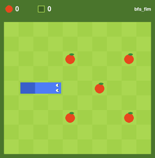
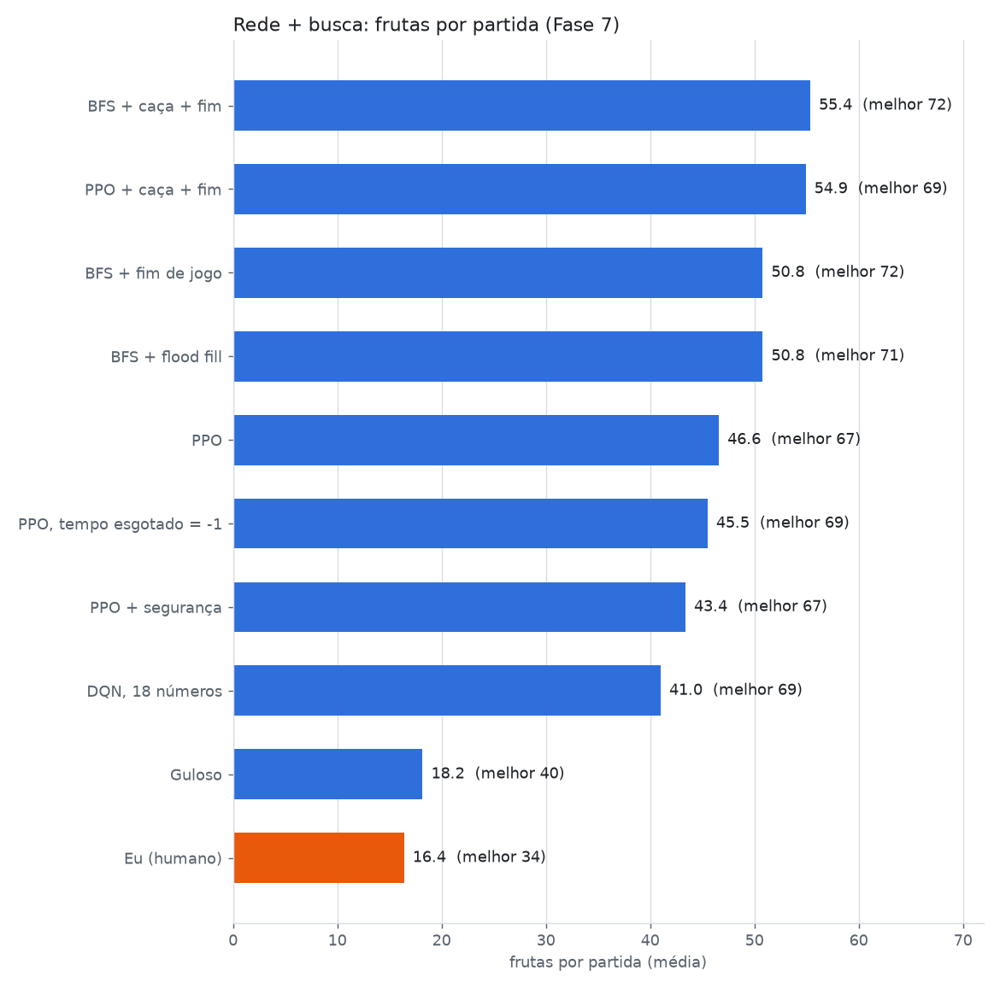

# Fase 7 — Rumo a zerar (rede + busca)

**Critério de conclusão:** taxa de vitória medida e limites explicados.
**Resultado:** a **primeira vitória de verdade** do projeto. O BFS com o solucionador de fim
de jogo zerou 1 das 1.000 partidas oficiais (0,1%): 72 frutas, cobra de 75 células +
15 obstáculos = as 90 células. A busca também levou a média de frutas a um novo recorde:
**55,35** (BFS + caça + fim) e **54,91** (PPO + caça + fim). E a conta de paridade explica
por que zerar é tão raro: **em ~64% das partidas, zerar é matematicamente impossível**.



## O que foi feito

| Arquivo | O que é |
|---|---|
| `scripts/winnability.py` | Joga um agente nas 1.000 sementes e mede em quantas zerar ainda era possível (paridade) |
| `agents/search.py` | `color_imbalance`, e três camadas de busca empilháveis sobre qualquer agente: `SafetyAgent` (segurança), `HunterAgent` (caça) e `EndgameAgent` (fim de jogo) |
| `agents/ppo.py`, `agents/dqn.py` | `action_scores(game)`: a 1ª, 2ª, 3ª opção da rede, para a busca usar |
| `scripts/evaluate.py` | `--wrap nome=base:camadas` (ex.: `bfs:caca,fim`) e contadores do que a busca fez |
| `scripts/train_ppo.py` | `--timeout-reward` (experimento: tempo esgotado = −1) |
| `scripts/merge_results.py` | Junta avaliações feitas em processos paralelos numa tabela e num gráfico |
| `tests/test_search.py` | 9 testes: paridade, veto de bolsão, caça, solucionador acha a vitória e prova impossibilidade |

## Conceitos novos

### 1. A conta do tabuleiro de xadrez (paridade)

Pinte o tabuleiro como um xadrez: cor = (linha + coluna) % 2. O 9×10 tem 45 casas de cada cor.
A cobra anda uma casa por vez, então **segmentos vizinhos do corpo têm sempre cores
diferentes**: o corpo alterna preto, branco, preto, branco...

Zerar = o corpo cobrir **todas** as casas sem obstáculo. Uma fila que alterna cores tem, no
máximo, 1 casa a mais de uma cor que da outra. Então:

```
16 obstáculos: 11 em casas pretas e 5 em brancas
livres: 45 - 11 = 34 pretas, 45 - 5 = 40 brancas   ->  diferença 6
um corpo alternado de 74 casas teria 37 + 37: nunca cobre 34 + 40  ->  IMPOSSÍVEL zerar
```

Os obstáculos nascem em casas sorteadas, então a diferença de cores é uma questão de sorte
(e um pouco de onde a cobra está quando eles nascem). Resultado, medido no fim das partidas:

| Diferença de cores no fim | 0 | 1 | 2 | 3 | 4 | 5+ |
|---|---:|---:|---:|---:|---:|---:|
| Partidas do BFS | 114 | 242 | 207 | 169 | 117 | 151 |
| Partidas do PPO | 133 | 224 | 206 | 170 | 117 | 150 |

**Só ~36% das partidas terminam com zerar ainda possível** (diferença ≤ 1), e isso é uma
condição necessária: passar nela não garante a vitória. É um teto que nenhum agente supera.

### 2. Rede + busca: a rede sugere, a busca confere

A rede (PPO ou DQN) dá notas para as 4 direções. A busca recebe essa ordem de preferência e
pode **vetar** jogadas. As camadas se empilham como "middlewares" de um servidor em JS: cada
uma recebe o pedido, decide se resolve sozinha ou passa para a de baixo.

- **Segurança:** veta jogadas que deixam a cabeça sem caminho até a cauda (o teste do BFS).
- **Caça (lookahead):** depois de 50 passos sem comer, procura (busca em profundidade) um
  caminho até uma fruta, **não necessariamente o mais curto**, depois do qual a cauda continua
  alcançável. O BFS só testava o caminho mais curto. Num caminho mais longo, a cauda anda mais
  antes de a cabeça chegar, e o corpo fica em outra posição na hora de comer.
- **Fim de jogo:** quando não sobra nenhuma célula vazia, o jogo fica 100% previsível: não
  nasce fruta nem obstáculo (não há onde), e cada passo só pode ir para uma fruta ou para a
  casa da própria cauda. Então a busca testa **todas** as sequências até achar uma que zere,
  ou provar que não existe nenhuma.

### 3. Por que a busca não pode copiar o jogo

O jeito fácil de "olhar para o futuro" seria copiar o `SnakeGame` e simular. Mas a cópia
levaria junto o gerador de números aleatórios, e a busca "veria" onde as próximas frutas vão
nascer. Seria colar na prova. Por isso a busca tem um simulador próprio, sem sorteio, e só
simula até o próximo sorteio (a próxima fruta comida). O solucionador de fim de jogo é a
exceção que confirma a regra: lá não existe sorteio nenhum pela frente.

### 4. Recompensa x o que o agente enxerga

Testei punir o tempo esgotado (−1, como morrer), para "dar voltas" deixar de ser grátis.
Não mudou nada (45,50 contra 46,59; 85% das partidas ainda por tempo). O motivo: os 18
números **não dizem há quantos passos a cobra está sem comer**. Ela não tem como saber que o
relógio está acabando, então a punição chega "do nada", e não há o que aprender com ela.
Uma recompensa só ensina o que a observação permite perceber.

## Como rodar

```powershell
# Paridade: em quantas partidas zerar ainda era possível
.venv\Scripts\python.exe scripts\winnability.py --agent bfs --out experiments\fase7_paridade\bfs.json
.venv\Scripts\python.exe scripts\winnability.py --model experiments/fase6_ppo/model.zip --out experiments\fase7_paridade\ppo.json

# PPO com tempo esgotado = -1 (15 min)
.venv\Scripts\python.exe scripts\train_ppo.py --timeout-reward -1 --steps 4000000 --out fase7_ppo_timeout

# Avaliações com busca (as com "caca" levam ~32 min cada; rodei as 3 em paralelo)
.venv\Scripts\python.exe scripts\evaluate.py --agents --wrap ppo_caca_fim=experiments/fase6_ppo/model.zip:caca,fim --out fase7_eval_ppo_caca --no-chart
.venv\Scripts\python.exe scripts\evaluate.py --agents --wrap bfs_caca_fim=bfs:caca,fim --out fase7_eval_bfs_caca --no-chart
.venv\Scripts\python.exe scripts\evaluate.py --agents --model ppo_timeout=experiments/fase7_ppo_timeout/model.zip --wrap ppo_seg=experiments/fase6_ppo/model.zip:seguranca bfs_fim=bfs:fim --out fase7_eval_outros --no-chart

# Tabela e gráfico juntando tudo
.venv\Scripts\python.exe scripts\merge_results.py --inputs fase6_comparacao fase7_eval_outros fase7_eval_ppo_caca fase7_eval_bfs_caca --only greedy dqn_18 ppo ppo_seg ppo_timeout ppo_caca_fim bfs bfs_fim bfs_caca_fim --out fase7_comparacao --chart docs/media/fase7_comparacao.png --title "Rede + busca: frutas por partida (Fase 7)"

# Assistir à vitória
.venv\Scripts\python.exe scripts\play.py --replay experiments\fase7_eval_outros\replays\bfs_fim_best.json
```

## Resultados

Mesmas 1.000 sementes oficiais (`158f340ed1ca`):

| Jogador | Média | Mediana | Melhor | Vitórias | Como terminou |
|---|---:|---:|---:|---:|---|
| Eu (20 partidas) | 16,40 | 14 | 34 | 0% | obstáculo 85% |
| PPO + segurança | 43,38 ± 0,82 | 46 | 67 | 0% | tempo 88% |
| PPO, tempo esgotado = −1 | 45,50 ± 0,78 | 48 | 69 | 0% | tempo 85% |
| PPO (Fase 6) | 46,59 ± 0,74 | 49 | 67 | 0% | tempo 83% |
| BFS (Fase 3) | 50,79 ± 0,74 | 53 | 71 | 0% | tempo 84% |
| BFS + fim de jogo | 50,79 ± 0,74 | 53 | 72 | **0,1%** | tempo 84% |
| PPO + caça + fim | 54,91 ± 0,76 | 59 | 69 | 0% | tempo 80%, corpo 12% |
| **BFS + caça + fim** | **55,35 ± 0,80** | **59** | **72** | **0,1%** | tempo 84% |



O que a busca fez nas 1.000 partidas (contadores do `evaluate.py`):

| Agente | Vetos da segurança | Caçadas tentadas / com refeição achada | Buscas de fim de jogo / vitórias achadas |
|---|---:|---:|---:|
| PPO + segurança | 1.387 | — | — |
| BFS + fim de jogo | — | — | 7.389 / **1** |
| PPO + caça + fim | — | 124.577 / 2.920 | 9.276 / 0 |
| BFS + caça + fim | — | 128.982 / 2.126 | 14.409 / **1** |

(Uma "busca" é uma chamada a cada passo; a mesma partida sem célula vazia gera várias.)

### O que os números dizem

1. **A caça é a melhor ideia da fase.** Procurar caminhos mais longos até a fruta deu +4,6
   frutas ao BFS (50,79 → 55,35) e **+8,3 ao PPO** (46,59 → 54,91), que passa o BFS puro. Em
   ~2% das vezes que a cobra ficava 50 passos sem comer, havia uma refeição segura que o
   caminho mais curto não enxergava.
2. **A segurança atrapalhou o PPO** (46,59 → 43,38). O veto é conservador demais: o teste da
   cauda reprova jogadas que a rede sabia que eram boas (a cauda se move, o teste finge que
   não). Ela troca mortes (17% → 11%) por ainda mais tempo esgotado (88%).
3. **O solucionador de fim de jogo funciona, mas quase nunca tem chance.** Só 1–4% das
   partidas terminam sem nenhuma célula vazia (37 do BFS, 13 do PPO). Lá, em quase
   todos os casos, ele **prova** que nenhuma sequência de jogadas come todas as frutas: elas
   estão em bolsões dos quais a cobra não sairia. Na única exceção, ele achou a vitória.
4. **Por que a vitória é tão rara: os três limites.**
   - **Paridade (o maior):** ~64% das partidas terminam com o mapa impossível de zerar,
     seja qual for o jogador.
   - **Bolsões no fim:** mesmo com a paridade a favor, as últimas frutas costumam cair em
     cantos de onde a cobra, já com ~70 células, não consegue sair. Esse é o caso do solucionador
     provando "impossível".
   - **O relógio:** 200 passos sem comer encerram a partida. Os agentes preferem dar voltas
     seguras a arriscar (80–88% das partidas terminam por tempo), e o PPO nem enxerga o relógio.
5. **Para ir além** seria preciso planejar desde o meio do jogo: escolher **onde estar quando
   um obstáculo nasce** (para manter a paridade a favor) e manter o corpo num caminho que
   passe por todas as casas (o "ciclo hamiltoniano" que robôs de Snake usam). Isso já é outro
   projeto; fica registrado como o limite desta abordagem.

## O que deu errado e como foi resolvido

- **Avaliações lentas.** Com a caça, cada partida leva ~2 s: 1.000 partidas levam ~32 min
  por agente. Rodei as avaliações em 3 processos paralelos e escrevi `merge_results.py` para
  juntar as tabelas (ele confere que todas usaram as mesmas sementes).
- **`--agents` vazio dava erro.** Para avaliar só agentes com busca, `--agents` passou a
  aceitar lista vazia.
- **A recompensa por tempo esgotado não pegou**, e a explicação veio de olhar o que a rede
  vê: o contador de passos sem comer não está na observação. Mudar isso seria um novo
  experimento de treino (observação de 19 números).
