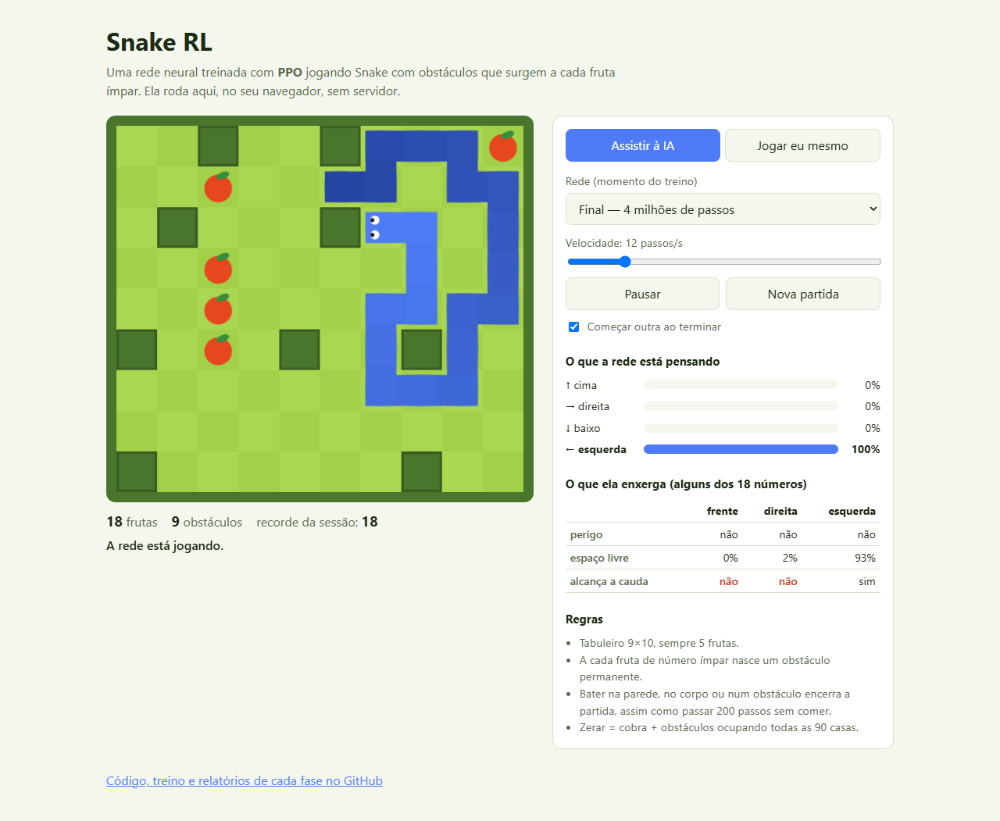
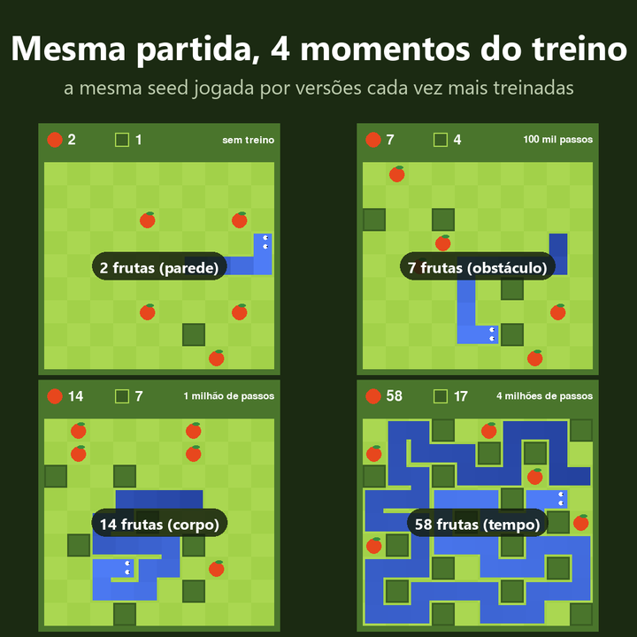

# Fase 8 — Portfólio: demo web, vídeo e README

**Critério de conclusão:** links prontos para o LinkedIn.
**Resultado:** a rede do PPO roda **no navegador**, sem servidor. Ela foi exportada para ONNX e
roda com o motor do jogo reescrito em JavaScript. Um teste confere o JS contra o Python. Também
saiu um vídeo de 56 s (1080×1080) gerado direto dos replays e das métricas, e o README foi
reescrito como a história do projeto.



## O que foi feito

| Arquivo | O que é |
|---|---|
| `scripts/export_onnx.py` | Exporta a rede do PPO (final e 4 checkpoints) para `web/models/*.onnx` e confere contra o PyTorch |
| `web/snake.js` | O motor do jogo em JS, tradução fiel de `snake/env.py` |
| `web/features.js` | Os 18 números da observação em JS (flood fill, cauda alcançável...) |
| `web/app.js`, `index.html`, `style.css` | A página: assistir à rede (com o que ela "pensa") ou jogar você mesmo |
| `scripts/make_web_fixtures.py` | Gera os gabaritos Python para o teste de paridade |
| `web/tests/parity.test.js` | 6 testes em Node: JS x Python em 138 estados reais + 1.000 partidas |
| `tests/test_web.py` | No pytest: ONNX joga igual ao SB3; e roda o teste do Node |
| `scripts/make_video.py` | O vídeo do LinkedIn: 7 cenas, pygame + ffmpeg |
| `.github/workflows/pages.yml` | Publica `web/` no GitHub Pages |
| `README.md` | Reescrito: resultados, história fase a fase, links |

## Conceitos novos

### 1. ONNX: a rede num arquivo que qualquer linguagem abre

A rede treinada vive dentro do PyTorch, em Python. O navegador não roda Python. ONNX é um
formato neutro para redes, como o PDF para documentos: o PyTorch "imprime" a rede num `.onnx`
(77 KB), e o `onnxruntime-web` abre e calcula em JavaScript.

Só exportamos o **ator**, a parte que escolhe a jogada:

```
18 números -> Linear(18→128) -> tanh -> Linear(128→128) -> tanh -> Linear(128→4) -> 4 notas
```

O crítico (que estima o valor do estado) só serve no treino, então ficou de fora.

### 2. Das 4 notas às probabilidades (softmax), passo a passo

A rede devolve 4 notas cruas, os "logits". O PPO joga com a maior. Para mostrar porcentagens na
tela, o JS aplica o softmax: eleva *e* a cada nota e divide pela soma.

```
notas:        cima 2,0   direita 0,5   baixo -1,0   esquerda 0,0
e^nota:            7,39          1,65         0,37          1,00     soma = 10,41
probabilidade:      71%           16%           4%           10%     -> joga "cima"
```

Em JS, `Math.exp(v - max)` em vez de `Math.exp(v)`: subtrair a maior nota não muda o resultado
e evita números gigantes.

### 3. Teste de paridade: por que reescrever em JS é perigoso

Se o JS calcular **um** dos 18 números diferente do Python (por exemplo, a fruta mais próxima
num empate), nada quebra: a rede só recebe uma "visão" que nunca viu no treino e joga pior,
em silêncio. Por isso:

1. o Python joga 40 partidas e tira "fotos" de 138 estados (cobra de 3 a 64 casas);
2. para cada foto, ele anota as respostas certas: os 18 números, as direções seguras, onde um
   obstáculo pode nascer e o resultado de um passo em cada direção;
3. o `parity.test.js` monta o mesmo estado em JS e compara tudo.

É o mesmo espírito dos testes de "snapshot" do Jest, com o Python como gabarito. Um detalhe do
`min()` do Python que precisou ser copiado: num empate, ele fica com o **primeiro** da lista,
então o JS usa `<` (e não `<=`) ao procurar a fruta mais próxima.

### 4. Mesmas regras, sorteios diferentes

O Python sorteia com o gerador do numpy (PCG64), que não existe no navegador. O JS usa o
mulberry32, um gerador pequeno de 6 linhas. Consequência: a seed 42 no navegador **não** dá a
mesma partida que a seed 42 no Python. As regras são idênticas (o teste confere), mas onde
nascem as frutas e os obstáculos muda. Para comparar o desempenho, rodei 300 partidas no JS (com
o Node e a mesma rede ONNX): **47,65 frutas de média**. No Python, nas 1.000 sementes oficiais, o
resultado foi 46,59 ± 0,74. É o mesmo agente.

### 5. O vídeo por "pipe"

Cada quadro é desenhado com pygame numa Surface, vira bytes RGB e é escrito na entrada do
ffmpeg, que comprime em H.264. Os dois programas rodam ao mesmo tempo, ligados por um "cano",
como `programa1 | programa2` no terminal. Nenhum PNG intermediário vai para o disco.

O ffmpeg vem dentro do pacote `imageio-ffmpeg`, então o `pip install` basta.

Roteiro (todo número sai de replays, `metrics.csv` e `summary.json`; nada digitado à mão):

| Tempo | Cena |
|---|---|
| 0–5 s | Gancho: a melhor partida do PPO, da 46ª à 67ª fruta |
| 5–9 s | Obstáculos piscando ao nascer |
| 9–21 s | Tela dividida: a mesma seed com 0, 100 mil, 1 milhão e 4 milhões de passos |
| 21–29 s | Curva de aprendizado animada, com a linha da minha média |
| 29–36 s | Barras: aleatório, eu, guloso, DQN, PPO, BFS, PPO + busca |
| 36–52 s | A primeira vitória e o limite da paridade |
| 52–56 s | Links |

## Como rodar

```powershell
# Exportar a rede (final + checkpoints) e conferir contra o PyTorch
.venv\Scripts\python.exe scripts\export_onnx.py

# Demo local em http://localhost:8000
.venv\Scripts\python.exe -m http.server 8000 --directory web

# Teste de paridade JS x Python (precisa do Node.js; também roda dentro do pytest)
.venv\Scripts\python.exe scripts\make_web_fixtures.py
node --test web/tests/parity.test.js

# Vídeo (~40 s para gerar) e a prévia (1 PNG por cena)
.venv\Scripts\python.exe scripts\make_video.py
.venv\Scripts\python.exe scripts\make_video.py --preview --out experiments\video_previa\x.mp4
```

## Resultados

- **ONNX = PyTorch:** em 1.000 observações aleatórias, a maior diferença entre as notas foi
  8,6 × 10⁻⁶. A escolha foi a mesma em 100% delas, nos 5 modelos. No pytest, o ONNX e o modelo
  do SB3 jogam 3 partidas inteiras escolhendo exatamente as mesmas jogadas.
- **JS = Python:** os 6 testes de paridade passam (138 estados, 1.000 partidas aleatórias em JS
  sem nenhuma invariante quebrada).
- **A demo joga como o original:** 47,65 frutas em 300 partidas no motor JS.
- **Vídeo:** `docs/media/snake_rl.mp4`, 55,7 s, 1080×1080, 1,9 MB.
- **Testes:** 105 no pytest (103 de antes + 2 novos).



## O que deu errado e como foi resolvido

- **Poucos gabaritos.** A 1ª versão do gerador fazia 10% de jogadas totalmente aleatórias, e as
  partidas morriam cedo (30 estados, cobra de no máximo 32). Agora o sorteio é só entre as
  jogadas seguras: são 138 estados, com cobra de até 64.
- **`node --test web/tests/`** dava `MODULE_NOT_FOUND` no Node 24. A solução foi passar o arquivo
  (`web/tests/parity.test.js`).
- **Barras de probabilidade invisíveis na demo.** Eram `<span>`, um elemento "inline", e
  elemento inline ignora `width`. Faltava `display: block`. Achei olhando a captura de tela,
  não o código.
- **Etiqueta de fim de partida escondia o tabuleiro** no vídeo (o tabuleiro todo ficava
  escurecido). Agora uma etiqueta pequena fica no meio, e dá para ver a cobra de 58 frutas.
- **A tela dividida encostava na borda de baixo.** As células encolheram de 40 para 39 px.
- **Publicação.** O workflow do GitHub Pages está pronto, mas só roda quando o Pages for ativado
  no repositório. Até lá, o link da demo no README e no vídeo não abre.
